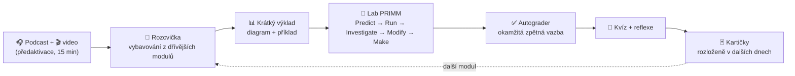

# Metodika kurzu – co používáme, proč a jak silné jsou důkazy

Kurz je navržený podle zjištění kognitivní psychologie a výzkumu výuky. U každé techniky uvádíme **míru jistoty** a typ důkazů. Většina výzkumu pochází ze školního a vysokoškolského prostředí (často z jiných oborů než IT) – přenos na firemní školení je pravděpodobný, ale přímo ověřený zřídka. To je hlavní omezení celé metodiky.

**Stupnice jistoty:** **vysoká** = opakované metaanalýzy s konzistentním výsledkem · **střední** = metaanalýzy s velkou variabilitou nebo méně studií · **nízká** = jednotlivé studie, teoretické zdůvodnění · **sporné** = odborná obec se neshoduje.

---

## 1. Přehled
| Technika | Kde v kurzu | Účinek (typický) | Jistota | Klíčové zdroje |
|---|---|---|---|---|
| **Vybavování z paměti** (retrieval practice) | rozcvička na začátku lekce, kvízy, kartičky, otázka na konci každé epizody a videa | g ≈ 0,5–0,6 oproti opakovanému studiu | **vysoká** | Roediger a Karpicke 2006; Dunlosky a kol. 2013; Adesope a kol. 2017 |
| **Rozložené opakování** (spacing) | kartičky Anki, rozcvičky z *dřívějších* modulů | robustní, roste s delším intervalem | **vysoká** | Cepeda a kol. 2006; Dunlosky a kol. 2013 |
| **Aktivní učení** místo přednášky | laby tvoří 50–70 % času | +0,47 SD ve zkouškách; 1,5× méně neúspěchů | **vysoká** (STEM, VŠ) | Freeman a kol. 2014 |
| **Řešené příklady → postupné ubírání opory** | PRIMM (číst → upravit → vytvořit), TODO v kostrách, záznamy terminálu | silný u začátečníků, u pokročilých slábne (*expertise reversal*) | **vysoká** pro začátečníky | Sweller a Cooper 1985; Renkl a Atkinson 2003; Kalyuga a kol. 2003 |
| **Předpověď před spuštěním** | krok *Predict* v každém labu | pozitivní, závisí na zpětné vazbě po předpovědi | **střední** | Brod 2021 |
| **PRIMM** | struktura všech labů | zlepšení v kvazi-experimentu (~500 žáků) | **střední** (školní prostředí) | Sentance, Waite a Kallia 2019 |
| **Okamžitá zpětná vazba** | `terraform test`, autograder, GitHub Actions | d ≈ 0,48, velký rozptyl podle typu | **střední až vysoká** | Hattie a Timperley 2007; Wisniewski a kol. 2020 |
| **Sebevysvětlování a vysvětlování druhým** | reflexe, „debugging relay“, párové programování | g ≈ 0,55 | **střední až vysoká** | Chi a kol. 1994; Bisra a kol. 2018 |
| **Produktivní selhání** (nejdřív problém, pak výklad) | Opravárna, „past“ v labech 04 a 05 | g ≈ 0,36 pro konceptuální porozumění, jen při dobrém návrhu | **střední / sporné** | Kapur 2016; Sinha a Kapur 2021 |
| **Prokládání** (interleaving) | míchané otázky v rozcvičkách a závěrečném kvízu | g ≈ 0,42, silně závisí na typu látky | **střední** | Brunmair a Richter 2019 |
| **Principy multimediálního učení** | video lekce: segmentace, signalizace, koherence, modalita; diagramy u každého modulu | střední až velké efekty v laboratorních studiích | **střední až vysoká** | Mayer 2021 |
| **Podcast jako příprava** (flipped classroom) | epizoda před každou lekcí | doplňkový přínos, slabší evidence | **nízká až střední** | Kay 2012 (přehled); van Alten a kol. 2019 (flipped) |
| **Párové programování** | závěrečný projekt, „debugging relay“ | malý pozitivní vliv na kvalitu, vyšší celkové úsilí | **střední** | Hannay a kol. 2009; McDowell a kol. 2006 |
| **Lehká gamifikace** | tabulka splněných labů v autograderu, mutační skóre | malé až střední efekty, velký rozptyl | **střední / sporné** | Sailer a Homner 2020 |
| **Prostředí bez instalace** (Codespaces) | `.devcontainer/` | snížení nadbytečné kognitivní zátěže | **nízká** (teoretické zdůvodnění) | Sweller 1988 (teorie kognitivní zátěže) |

### Co záměrně **nepoužíváme**
- **Přizpůsobení „stylům učení“** (vizuální/auditivní typ). Kontrolované studie hypotézu „meshing“ nepotvrdily (Pashler a kol. 2008). Místo toho dostává každé téma více forem (text, diagram, audio, praxe) pro všechny.
- **Zvýrazňování a opakované čtení** jako hlavní strategie – v přehledu Dunloskyho a kol. (2013) nízká užitečnost.
- **Dlouhá videa.** Segmentace (Mayer) i data o sledovanosti výukových videí (Guo a kol. 2014, pozorovací studie MOOC) ukazují výhodu krátkých celků; lekce mají 1–2 minuty.

---

## 2. Jak techniky do sebe zapadají

### Konstruktivní souhlas (Biggs, 1996)
Cíle učení každého modulu jsou formulované slovesy podle revidované Bloomovy taxonomie (vysvětlit, předpovědět, navrhnout, zdůvodnit) a **ověřují se aktivitou stejné úrovně**: kdo má „předpovědět plán“, ten v labu plán předpovídá; kdo má „navrhnout modul“, ten v závěrečném projektu modul navrhuje a obhajuje. Testy v labech ověřují výsledek, rubrika závěrečného projektu i rozhodnutí.

### Formativní vs. sumativní hodnocení
| | Formativní (během kurzu) | Sumativní (na konci) |
|---|---|---|
| Nástroje | rozcvičky, kvízy, `terraform test`, autograder, mutační skóre, reflexe | závěrečný projekt s rubrikou a akceptačním testem |
| Účel | ukázat mezery, dokud je čas je zaplnit | ověřit přenos do nové úlohy |

---

## 3. Návrhová rozhodnutí specifická pro Terraform
1. **Docker místo cloudu** v labech 03–08: nulové náklady a riziko → bezpečné prostředí pro chybování (předpoklad produktivního selhání i psychologického bezpečí skupiny). Principy (provider, stav, graf, drift) jsou totožné.
2. **Předpověď plánu** jako opakovaný rituál: čtení plánu je nejdůležitější profesní dovednost a nejčastější zdroj incidentů (`-/+` přehlédnutý v review).
3. **Chyby záměrně vyvolané** (count a posun indexů, přejmenování bez `moved`, import kontejneru, citlivá data ve stavu): mylné představy, které se jinak objeví až v produkci.
4. **Testy jako zadání** (`tests/` ve `start/`): účastník ví, *co* má vzniknout, a dostane zpětnou vazbu bez čekání na lektora.
5. **Mutační testování** v labu 07: z „mám testy“ dělá „vím, co mé testy zachytí“ – měřitelný cíl místo pocitu.

---

## 4. Omezení a otevřené otázky
- **Přenos z jiných domén.** Velikosti účinků pocházejí převážně ze vzdělávání v jiných oborech a z jiné věkové skupiny. Pro firemní IT školení chybí kontrolované studie; očekáváme podobný směr, ne nutně stejnou velikost.
- **Syntetický hlas.** Podcast i videa používají syntézu řeči. Tzv. *voice principle* (Mayer) předpovídá horší učení ze strojového hlasu; novější studie s kvalitní syntézou rozdíl často nenacházejí (Craig a Schroeder 2017). Kvalita offline modelu je nižší – doporučujeme přegenerovat lepším backendem ([podcast/README.md](podcast/README.md)).
- **Podcasty ve výuce** mají zatím slabší a heterogenní evidenci; v kurzu slouží jako doplněk, ne náhrada aktivní práce.
- **Gamifikace** může u části lidí snížit vnitřní motivaci; proto je minimální (přehled splněných úloh, žádné žebříčky).
- **Měřte sami:** doporučujeme krátký vstupní a výstupní test (např. 10 otázek z kvízů) a sběr exit ticketů. Bez dat z vlastních běhů kurzu jsou výše uvedené efekty jen očekáváním.

---

## Literatura
- Adesope, O. O., Trevisan, D. A., Sundararajan, N. (2017). Rethinking the use of tests: A meta-analysis of practice testing. *Review of Educational Research*, 87(3), 659–701.
- Biggs, J. (1996). Enhancing teaching through constructive alignment. *Higher Education*, 32, 347–364.
- Bisra, K. a kol. (2018). Inducing self-explanation: A meta-analysis. *Educational Psychology Review*, 30, 703–725.
- Brod, G. (2021). Predicting as a learning strategy. *Psychonomic Bulletin & Review*, 28, 1839–1847.
- Brunmair, M., Richter, T. (2019). Similarity matters: A meta-analysis of interleaved learning and its moderators. *Psychological Bulletin*, 145(11), 1029–1052.
- Cepeda, N. J. a kol. (2006). Distributed practice in verbal recall tasks: A review and quantitative synthesis. *Psychological Bulletin*, 132(3), 354–380.
- Chi, M. T. H. a kol. (1994). Eliciting self-explanations improves understanding. *Cognitive Science*, 18(3), 439–477.
- Craig, S. D., Schroeder, N. L. (2017). Reconsidering the voice effect when learning from a virtual human. *Computers & Education*, 114, 193–205.
- Dunlosky, J. a kol. (2013). Improving students' learning with effective learning techniques. *Psychological Science in the Public Interest*, 14(1), 4–58.
- Freeman, S. a kol. (2014). Active learning increases student performance in science, engineering, and mathematics. *PNAS*, 111(23), 8410–8415.
- Guo, P. J., Kim, J., Rubin, R. (2014). How video production affects student engagement: An empirical study of MOOC videos. *Proceedings of L@S '14*, 41–50.
- Hannay, J. E. a kol. (2009). The effectiveness of pair programming: A meta-analysis. *Information and Software Technology*, 51(7), 1110–1122.
- Hattie, J., Timperley, H. (2007). The power of feedback. *Review of Educational Research*, 77(1), 81–112.
- Kalyuga, S. a kol. (2003). The expertise reversal effect. *Educational Psychologist*, 38(1), 23–31.
- Kapur, M. (2016). Examining productive failure, productive success, unproductive failure, and unproductive success in learning. *Educational Psychologist*, 51(2), 289–299.
- Kay, R. H. (2012). Exploring the use of video podcasts in education: A comprehensive review of the literature. *Computers in Human Behavior*, 28(3), 820–831.
- Mayer, R. E. (2021). *Multimedia Learning* (3. vyd.). Cambridge University Press.
- McDowell, C. a kol. (2006). Pair programming improves student retention, confidence, and program quality. *Communications of the ACM*, 49(8), 90–95.
- Pashler, H. a kol. (2008). Learning styles: Concepts and evidence. *Psychological Science in the Public Interest*, 9(3), 105–119.
- Renkl, A., Atkinson, R. K. (2003). Structuring the transition from example study to problem solving. *Educational Psychologist*, 38(1), 15–22.
- Roediger, H. L., Karpicke, J. D. (2006). Test-enhanced learning. *Psychological Science*, 17(3), 249–255.
- Sailer, M., Homner, L. (2020). The gamification of learning: A meta-analysis. *Educational Psychology Review*, 32, 77–112.
- Sentance, S., Waite, J., Kallia, M. (2019). Teaching computer programming with PRIMM: A sociocultural perspective. *Computer Science Education*, 29(2–3), 136–176.
- Sinha, T., Kapur, M. (2021). When problem solving followed by instruction works: Evidence for productive failure. *Review of Educational Research*, 91(5), 761–798.
- Sweller, J. (1988). Cognitive load during problem solving. *Cognitive Science*, 12(2), 257–285.
- Sweller, J., Cooper, G. A. (1985). The use of worked examples as a substitute for problem solving in learning algebra. *Cognition and Instruction*, 2(1), 59–89.
- van Alten, D. C. D. a kol. (2019). Effects of flipping the classroom on learning outcomes and satisfaction: A meta-analysis. *Educational Research Review*, 28, 100281.
- Wisniewski, B., Zierer, K., Hattie, J. (2020). The power of feedback revisited: A meta-analysis of educational feedback research. *Frontiers in Psychology*, 10, 3087.
