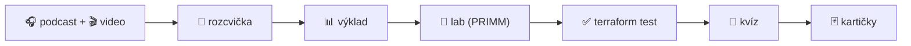

# Terraform: od nuly k produkci 🇨🇿

[](https://github.com/ravisileb/terraform_repo/actions/workflows/skoleni-ci.yml)
[](https://codespaces.new/ravisileb/terraform_repo)


Praktický kurz infrastruktury jako kódu s Terraformem v češtině. **Bez cloudového účtu a bez nákladů** – laby běží proti Dockeru na vašem počítači nebo v GitHub Codespaces. Kurz je postavený na metodách s empirickou oporou: vybavování z paměti, rozložené opakování, předpověď před spuštěním (PRIMM), okamžitá zpětná vazba z automatických testů ([METODIKA.md](METODIKA.md)).

| Co | Kolik |
|---|---|
| 📚 Moduly s výkladem, diagramy a kvízy | 11 |
| 🧪 Laby s kostrou, testy a řešením | 8 + závěrečný projekt |
| 🔧 Break-fix úlohy (Opravárna) | 10 |
| 🎧 Podcast (dialog, přepisy, RSS) | 11 epizod, 51 min |
| 🎬 Video lekce s titulky | 9, celkem 12 min |
| 🖥️ Záznamy terminálu ze skutečných běhů | 4 |
| 🃏 Kartičky pro Anki | 92 |
| 🤖 Autograder (lokálně i v GitHub Actions) | ✔ |

## Jak začít
1. **Prostředí:** [Codespaces](https://codespaces.new/ravisileb/terraform_repo) (nic neinstalujete) nebo lokálně Terraform ≥ 1.10 + Docker – viz [modul 00](moduly/00-priprava/README.md). Ověření: `./skoleni/nastroje/overeni-prostredi.sh`
2. **Fork** repozitáře – ve forku vám GitHub Actions po každém pushi ukáže, které laby máte splněné.
3. Pusťte si **[podcast ep. 00](podcast/ep00-jak-se-ucit.md)** – 5 minut o tom, jak se v kurzu učit.
4. Jděte po modulech. Každý má stejný rytmus:



## Osnova
| # | Modul | Podcast | Video | Lab | Čas |
|---|---|---|---|---|---|
| 00 | [Příprava prostředí a jak se učit](moduly/00-priprava/README.md) | [ep00](podcast/ep00-jak-se-ucit.md) | – | kontrola prostředí | 30 min |
| 01 | [Proč infrastruktura jako kód](moduly/01-proc-iac/README.md) | [ep01](podcast/ep01-proc-infrastruktura-jako-kod.md) | [▶](video/README.md#lekce-01) | aktivita „Rekonstrukce“ | 45 min |
| 02 | [HCL a workflow](moduly/02-hcl-a-workflow/README.md) | [ep02](podcast/ep02-hcl-a-workflow.md) | [▶](video/README.md#lekce-02) | [Lab 01 – První kroky](labs/lab01-prvni-kroky/README.md) | 90 min |
| 03 | [Proměnné, výstupy, citlivá data](moduly/03-promenne-a-vystupy/README.md) | [ep03](podcast/ep03-promenne-a-vystupy.md) | [▶](video/README.md#lekce-03) | [Lab 02 – Proměnné](labs/lab02-promenne/README.md) | 90 min |
| 04 | [Providery a graf závislostí](moduly/04-providery-a-zavislosti/README.md) | [ep04](podcast/ep04-providery-a-zavislosti.md) | [▶](video/README.md#lekce-04) | [Lab 03 – Docker](labs/lab03-docker/README.md) | 90 min |
| 05 | [State](moduly/05-state/README.md) | [ep05](podcast/ep05-state.md) | [▶](video/README.md#lekce-05) | [Lab 04 – State, import, moved](labs/lab04-state/README.md) | 90 min |
| 06 | [Meta-argumenty a výrazy](moduly/06-meta-argumenty/README.md) | [ep06](podcast/ep06-count-for-each.md) | [▶](video/README.md#lekce-06) | [Lab 05 – count vs. for_each](labs/lab05-for-each/README.md) | 90 min |
| 07 | [Moduly](moduly/07-moduly/README.md) | [ep07](podcast/ep07-moduly.md) | [▶](video/README.md#lekce-07) | [Lab 06 – Moduly](labs/lab06-moduly/README.md) | 90 min |
| 08 | [Testování a kvalita](moduly/08-testovani/README.md) | [ep08](podcast/ep08-testovani.md) | [▶](video/README.md#lekce-08) | [Lab 07 – Testy a mutace](labs/lab07-testovani/README.md) | 90 min |
| 09 | [Týmová práce a CI/CD](moduly/09-tymova-prace-a-ci-cd/README.md) | [ep09](podcast/ep09-tym-a-ci-cd.md) | [▶](video/README.md#lekce-09) | [Lab 08 – GitHub Actions](labs/lab08-ci-cd/README.md) | 60 min |
| 10 | [Závěrečný projekt a cesta dál](moduly/10-zaverecny-projekt/README.md) | [ep10](podcast/ep10-cesta-dal.md) | – | [Mini platforma](labs/capstone/README.md) | 3–4 h |
| ★ | [Opravárna – 10 break-fix úloh](opravarna/README.md) | | | průběžně | 1–2 h |

## Ověření práce (autograder)
```bash
./skoleni/nastroje/zkontroluj.sh lab03                 # jeden lab (vaše práce ve start/)
./skoleni/nastroje/zkontroluj.sh lab03 --integrace     # + integrační test proti Dockeru
./skoleni/nastroje/zkontroluj.sh vse                   # přehled všech labů
./skoleni/nastroje/zkontroluj.sh opravarna             # jsou všechny úlohy opravené?
```
Laby obsahují testy `terraform test` (s `mock_provider` běží i bez Dockeru), lab 04 kontrolu stavu, lab 07 mutační testování a lab 08 kontrolu workflow. Referenční řešení jsou v adresářích `reseni/` a v CI se při každé změně ověřují ([`.github/workflows/skoleni-ci.yml`](../.github/workflows/skoleni-ci.yml)).

## Struktura
```
skoleni/
├── README.md              ← jste tady
├── METODIKA.md            ← proč je kurz postavený takhle (s mírou jistoty důkazů)
├── PRUVODCE-LEKTORA.md    ← rozvrh 2 dny, vedení lekcí, časté problémy
├── TAHAK.md               ← Terraform na jednu stránku
├── moduly/                ← výklad, diagramy, kvízy (00–10)
├── labs/                  ← lab01–lab08 + capstone: README, start/, reseni/, testy
├── opravarna/             ← 10 rozbitých konfigurací se skutečnými chybovými hláškami
├── podcast/               ← přepisy, MP3, RSS feed, obal
├── video/                 ← video lekce (MP4 + SRT) a záznamy terminálu (GIF/MP4/cast)
├── obrazky/               ← SVG diagramy
├── karticky/              ← kartičky pro Anki (TSV)
└── nastroje/              ← autograder, kontrola prostředí, generátory podcastu a videí
```

## Pro lektory
[PRUVODCE-LEKTORA.md](PRUVODCE-LEKTORA.md) – dvoudenní rozvrh, příprava, vedení rozcvičky a labů, řešení častých problémů, hodnocení kurzu.

## Technické požadavky
Terraform ≥ 1.10 (ověřeno s 1.17), provider Docker `kreuzwerker/docker` 4.x, Docker Engine, Python 3 (lab 07), volitelně TFLint. Kurz je psaný pro Terraform; většina labů funguje i s OpenTofu.

## Licence a zdroje
Obsah kurzu spadá pod licenci repozitáře ([LICENSE](../LICENSE)). Podcast i video používají syntetický hlas; generátory a texty jsou součástí repozitáře ([nastroje/media](nastroje/media/README.md)). Terraform je ochranná známka společnosti HashiCorp (IBM); kurz není oficiálním materiálem HashiCorpu.
