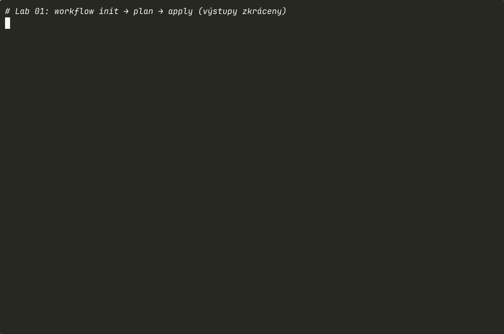

# Lab 01 – První kroky: `init → plan → apply → destroy`

| Modul | Čas | Obtížnost | Potřebujete |
|---|---|---|---|
| [02 – HCL a workflow](../../moduly/02-hcl-a-workflow/README.md) | 45 min | ★☆☆ | Terraform ≥ 1.10 (žádný cloud, žádný Docker) |

## Cíle
Po labu umíte:
1. **napsat** blok `terraform {}` s `required_providers` a vysvětlit, proč se verze pinují,
2. **provést** celý životní cyklus `init → plan → apply → destroy`,
3. **přečíst** plán a rozlišit symboly `+`, `~`, `-/+`, `-`,
4. **propojit** dva zdroje referencí a vysvětlit, jak z ní vzniká graf závislostí.

Lab je postaven na metodě **PRIMM** (Predict → Run → Investigate → Modify → Make). Předpovědi si pište do souboru nebo na papír **před** spuštěním příkazu – srovnání předpovědi s realitou je to, co z cvičení dělá učení, ne jen opisování.

---

## 0. Příprava
```bash
cd skoleni/labs/lab01-prvni-kroky/start
```
Soubor `main.tf` obsahuje kostru s úkoly `TODO`. Složka `tests/` obsahuje automatické testy, které vám řeknou, jestli je hotovo.

## 1. Doplňte konfiguraci
Splňte TODO 1–5 v `main.tf`. Nápověda k syntaxi:

```hcl
resource "<TYP>" "<LOKÁLNÍ_JMÉNO>" {
  argument = hodnota
}
```

<details>
<summary>Nápověda 1 – kde najdu argumenty zdroje?</summary>

V dokumentaci providera v registry: `random_pet` → <https://registry.terraform.io/providers/hashicorp/random/latest/docs/resources/pet>, `local_file` → <https://registry.terraform.io/providers/hashicorp/local/latest/docs/resources/file>.
</details>

<details>
<summary>Nápověda 2 – jak vložit hodnotu jiného zdroje do textu?</summary>

Interpolací: `"Ahoj, jsem ${random_pet.jmeno.id}!\n"`. Reference má tvar `<TYP>.<JMÉNO>.<ATRIBUT>`.
</details>

## 2. Predict – předpověď
Než spustíte `terraform plan`, odpovězte:
- **P1:** Kolik zdrojů plán vytvoří (`to add`)?
- **P2:** Který zdroj se vytvoří jako první a proč?
- **P3:** Zobrazí plán už konkrétní jméno mazlíčka?

## 3. Run – spusťte
```bash
terraform init      # stáhne providery, vytvoří .terraform/ a .terraform.lock.hcl
terraform fmt       # sjednotí formátování
terraform validate  # syntaktická a typová kontrola bez přístupu k API
terraform plan      # co by se stalo
terraform apply     # provede plán (potvrďte "yes")
cat vystup/pozdrav.txt
```
Porovnejte výstup s předpovědí P1–P3.

<details>
<summary>🎬 Záznam celého labu v terminálu (otevřete až po vlastním spuštění)</summary>


</details>

## 4. Investigate – prozkoumejte
```bash
terraform state list
terraform state show random_pet.jmeno
terraform output
terraform output -raw jmeno_mazlicka
terraform graph            # graf závislostí ve formátu DOT
```
Otázky:
- **I1:** Co je v souboru `.terraform.lock.hcl` a proč by se v reálném projektu měl commitovat?
- **I2:** Co se stane, když spustíte `terraform apply` podruhé bez změny kódu? Proč?
- **I3:** Najděte v `terraform.tfstate` atribut `content` souboru. Proč tam Terraform ukládá i obsah?

## 5. Modify – upravte
1. **Predict:** Změňte text pozdravu na `"Čau, já jsem …"`. Bude to změna *in-place* (`~`), nebo *replace* (`-/+`)?
2. Spusťte `terraform plan` a ověřte. Hledejte v plánu text `# forces replacement`.
3. **Predict:** Změňte `length` v `random_pet` na `3`. Co se stane se souborem a proč?
4. Smažte ručně `vystup/pozdrav.txt` a spusťte `terraform plan`. Co Terraform zjistil? (Tomuto jevu se říká *drift*.)

## 6. Make – vytvořte
Bez návodu přidejte:
- druhý soubor `vystup/info.txt`, který obsahuje datum vytvoření (zdroj `time_static` z providera `hashicorp/time`, nebo funkci `timestamp()` – zjistěte, proč je `timestamp()` v tomto případě špatný nápad),
- výstup `pocet_znaku` s délkou pozdravu (funkce `length`).

## 7. Ověření
```bash
terraform test
```
Očekávaný výsledek: `Success! 3 passed, 0 failed.` Testy si vytvoří vlastní dočasné zdroje a po sobě je smažou – váš stav neovlivní.

Alternativně z kořene repozitáře: `./skoleni/nastroje/zkontroluj.sh lab01`.

## 8. Úklid
```bash
terraform destroy
```

## 9. Reflexe (exit ticket, 3 minuty)
1. Jednou větou: jaký je rozdíl mezi `plan` a `apply`?
2. Co vás v plánu překvapilo?
3. Kde v reálné práci by vás `-/+` (replace) mohlo bolet?

---

<details>
<summary>Diskuse k předpovědím (otevřete až po odevzdání)</summary>

- **P1:** 2 zdroje (`random_pet`, `local_file`).
- **P2:** `random_pet`, protože `local_file` na něj odkazuje – reference vytváří implicitní závislost v grafu.
- **P3:** Ne. Jméno vzniká až při `apply`; v plánu je `(known after apply)`.
- **I2:** Nic – Terraform je *idempotentní*: porovná požadovaný stav (kód) se skutečným a nenajde rozdíl.
- **I3:** Provider potřebuje znát poslední známý stav, aby uměl detekovat změny. Proto state může obsahovat citlivá data a musí se chránit.
- **Modify 1:** `-/+` – u `local_file` vynucuje změna `content` náhradu (soubor se smaže a vytvoří znovu).
- **Modify 3:** změna `length` nahradí `random_pet` → nové jméno → změní se `content` → nahradí se i soubor. Změna se šíří grafem.
- **Make:** `timestamp()` se vyhodnocuje při každém plánu, takže by plán nikdy nebyl prázdný. `time_static` uloží čas do stavu jednou.
</details>

Referenční řešení: [`reseni/main.tf`](reseni/main.tf)
