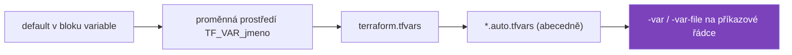

# Lab 02 – Proměnné, typy, validace, lokální hodnoty a šablony

| Modul | Čas | Obtížnost | Potřebujete |
|---|---|---|---|
| [03 – Proměnné a výstupy](../../moduly/03-promenne-a-vystupy/README.md) | 60 min | ★★☆ | Terraform ≥ 1.10 |

## Scénář
Tým potřebuje generovat konfigurační soubor aplikace pro tři prostředí (`dev`, `test`, `prod`). Pravidla:
- název aplikace musí odpovídat jmenné konvenci,
- v `prod` musí běžet alespoň 2 repliky,
- povinné štítky (`aplikace`, `prostredi`, `spravuje`) nesmí nikdo přepsat,
- heslo k databázi se nesmí objevit ve výpisu plánu.

## Cíle
1. **Deklarovat** proměnné s typy `string`, `number`, `list(number)`, `map(string)`.
2. **Napsat** validace včetně validace, která odkazuje na jinou proměnnou (Terraform ≥ 1.9).
3. **Použít** `locals`, `merge()` a `templatefile()` s cyklem `%{ for }`.
4. **Vysvětlit**, co dělá `sensitive = true` – a co **nedělá**.

## Pořadí přednosti hodnot proměnných

Vpravo = vyšší priorita. Pozdější zdroj přepisuje dřívější.

---

## 1. Doplňte TODO 1–12
```bash
cd skoleni/labs/lab02-promenne/start
terraform init
```
Soubory: `variables.tf` (TODO 1–6), `main.tf` (TODO 7–9), `outputs.tf` (TODO 10–11), `sablony/app.conf.tftpl` (TODO 12).

<details>
<summary>Nápověda – validace</summary>

```hcl
validation {
  condition     = contains(["dev", "test", "prod"], var.prostredi)
  error_message = "prostredi musí být jedno z: dev, test, prod."
}
```
`condition` musí vrátit `true` pro platnou hodnotu. Pro regex použijte `can(regex("...", var.x))` – `regex` při neshodě vyhodí chybu a `can` ji převede na `false`.
</details>

<details>
<summary>Nápověda – merge() a pořadí</summary>

`merge(a, b)` – při kolizi klíčů vyhrává **poslední** mapa. Chcete-li, aby povinné štítky nešly přepsat, musí být až za uživatelskými.
</details>

## 2. Predict
- **P1:** Co vypíše `terraform plan -var-file=prod.tfvars`? (Prohlédněte si `prod.tfvars`.)
- **P2:** Když spustíte `terraform plan` bez `-var-file` a bez `TF_VAR_heslo_db`, co se stane?
- **P3:** Bude heslo vidět v souboru `terraform.tfstate`?

## 3. Run
```bash
export TF_VAR_heslo_db='super-tajne'
terraform plan  -var-file=dev.tfvars
terraform apply -var-file=dev.tfvars
cat vystup/dev/app.conf
terraform output
terraform output -raw heslo_db     # citlivý výstup lze vyžádat explicitně
terraform plan  -var-file=prod.tfvars
```

## 4. Investigate
- **I1:** Proč selhal plán pro `prod`? Opravte `prod.tfvars` tak, aby prošel.
- **I2:** Spusťte `grep DB_PASSWORD terraform.tfstate`. Co z toho plyne pro uložení stavu?
- **I3:** V `prod.tfvars` je `spravuje = "rucne"`. Jakou hodnotu má štítek v `app.conf`? Proč?
- **I4:** Vyzkoušejte `terraform console` a v něm:
  ```
  var.porty
  local.stitky
  [for p in var.porty : "port-${p}"]
  { for k, v in local.stitky : upper(k) => v }
  ```

## 5. Modify
1. Přidejte proměnnou `log_level` (`debug`/`info`/`warn`/`error`, výchozí `info`) a vypište ji v šabloně.
2. Změňte typ `porty` na `set(number)`. Co se změní v pořadí řádků `listen`? Proč?
3. Odstraňte `sensitive = true` z výstupu `heslo_db` a spusťte `terraform plan`. Přečtěte si chybovou hlášku – Terraform hlídá šíření citlivých hodnot.

## 6. Make
Vytvořte `test.tfvars` a třetí prostředí. Přidejte proměnnou `vlastnik` typu `object({ jmeno = string, email = string })` a validaci, že e-mail končí na `@firma.cz`.

## 7. Ověření
```bash
terraform test     # očekáváno: 7 passed, 0 failed
```
Testy ověřují i to, že validace **odmítnou** špatné vstupy (`expect_failures`).

## 8. Úklid
```bash
terraform destroy -var-file=dev.tfvars
unset TF_VAR_heslo_db
```

## 9. Reflexe
1. Kdy použít `variable` a kdy `locals`?
2. `sensitive = true` skrývá hodnotu ve výpisu. Kde všude ale hodnota dál existuje?
3. Jak byste heslo do Terraformu předali v CI/CD? (Podklad pro modul 09.)

---

<details>
<summary>Diskuse k předpovědím</summary>

- **P1:** Chyba validace `V prostředí prod musí běžet alespoň 2 repliky.` Validace běží ještě před plánem – je to nejlevnější místo, kde zachytit chybu.
- **P2:** Terraform se interaktivně zeptá na `heslo_db` (nemá výchozí hodnotu). V CI s `-input=false` skončí chybou.
- **P3:** Ano. `sensitive` řeší pouze **zobrazení** v CLI. Stav obsahuje hodnoty v čitelné podobě, proto se ukládá do šifrovaného backendu s řízeným přístupem. Od Terraformu 1.10 existují `ephemeral` proměnné a od 1.11 *write-only* atributy, které se do stavu neukládají vůbec – viz modul 03.
- **I3:** `"terraform"` – povinné štítky jsou v `merge()` poslední.
- **Modify 2:** `set` nemá pořadí podle zápisu; Terraform čísla v množině řadí vzestupně.
</details>

Referenční řešení: [`reseni/`](reseni/)
