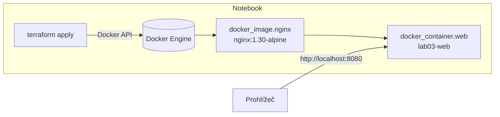
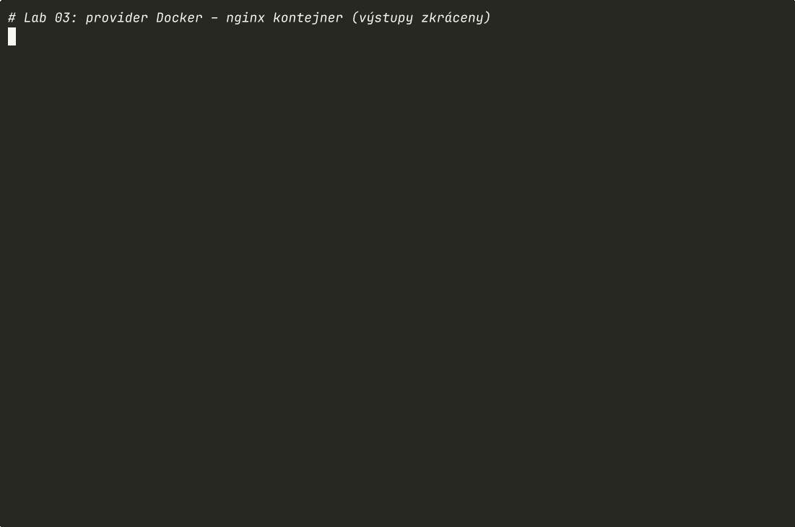

# Lab 03 – Provider Docker: první reálná infrastruktura

| Modul | Čas | Obtížnost | Potřebujete |
|---|---|---|---|
| [04 – Providery, zdroje a závislosti](../../moduly/04-providery-a-zavislosti/README.md) | 60 min | ★★☆ | Terraform ≥ 1.10, běžící Docker |

## Proč Docker?
Docker je „cloud na vašem notebooku“: provider `kreuzwerker/docker` se chová stejně jako providery AWS, Azure nebo GCP (volá API, vytváří zdroje, ukládá jejich ID do stavu), ale nic nestojí a chyba nic nerozbije. Principy si zažijete bez rizika a bez účtu u cloudu.

## Cíle
1. **Nakonfigurovat** provider včetně nepovinného připojení k Docker démonu.
2. **Vytvořit** image a kontejner a **vysvětlit** implicitní závislost přes referenci.
3. **Rozlišit** změny, které zdroj upraví na místě, a změny, které ho nahradí.
4. **Ověřit** infrastrukturu dvěma typy testů: jednotkovým (mock) a integračním (reálné nasazení + HTTP).

## Architektura


---

## 0. Kontrola Dockeru
```bash
docker version          # musí odpovědět Client i Server
cd skoleni/labs/lab03-docker/start
```
<details>
<summary>macOS / Windows / Podman – Terraform se nepřipojí k Dockeru</summary>

- **Docker Desktop na macOS:** `export DOCKER_HOST=unix://$HOME/.docker/run/docker.sock` (nebo v Docker Desktop zapněte *Allow the default Docker socket to be used*).
- **Windows:** `host = "npipe:////.//pipe//docker_engine"` – předejte přes `-var docker_host=...`.
- **Colima:** `export DOCKER_HOST=unix://$HOME/.colima/default/docker.sock`
- **Podman:** `export DOCKER_HOST=unix://$(podman machine inspect --format '{{.ConnectionInfo.PodmanSocket.Path}}')`
- **GitHub Codespaces:** funguje bez úprav (docker-in-docker je v devcontaineru).
</details>

## 1. Doplňte TODO 1–4 v `main.tf`
Dokumentace: [docker_image](https://registry.terraform.io/providers/kreuzwerker/docker/latest/docs/resources/image), [docker_container](https://registry.terraform.io/providers/kreuzwerker/docker/latest/docs/resources/container).

## 2. Predict
- **P1:** V jakém pořadí Terraform zdroje vytvoří? Podle čeho to pozná?
- **P2:** Změníte `titulek`. Bude kontejner upraven (`~`), nebo nahrazen (`-/+`)?
- **P3:** Kontejner ručně zastavíte (`docker stop lab03-web`). Co ukáže `terraform plan`?

## 3. Run
```bash
terraform init
terraform plan -out=tfplan        # uložený plán = přesně to, co se provede
terraform apply tfplan
curl -s localhost:8080 | grep h1  # nebo otevřete v prohlížeči
docker ps --filter name=lab03
```

<details>
<summary>🎬 Záznam labu v terminálu (otevřete až po vlastním spuštění)</summary>


</details>

## 4. Investigate
```bash
terraform graph | grep -- '->'    # hrany grafu závislostí
terraform state show docker_container.web | head -30
terraform plan -var titulek="Nazdar"
docker stop lab03-web && terraform plan
```
- **I1:** Proč se při změně `titulek` kontejner nahrazuje? Najděte v plánu `# forces replacement`.
- **I2:** U kterých typů zdrojů v cloudu by „replace“ znamenal výpadek nebo ztrátu dat?
- **I3:** Proč je `docker_image.keep_locally = true` rozumné v labu, ale v produkci o tom musíte přemýšlet?

## 5. Modify
1. Přidejte proměnnou `pocet_pokusu_restartu` a argument `restart = "on-failure"` + `max_retry_count`.
2. Přidejte blok `healthcheck` (busybox v alpine má `wget`):
   ```hcl
   healthcheck {
     test     = ["CMD", "wget", "-q", "--spider", "http://localhost/"]
     interval = "10s"
   }
   ```
3. Přidejte zdroj `docker_network` a připojte k ní kontejner blokem `networks_advanced`. Ověřte v `terraform graph`, že vznikla nová hrana.

## 6. Make
Přidejte druhý kontejner `lab03-api` z image `traefik/whoami:v1.11` na portu 8081. Výstup `url_api`. Kontejnery mají sdílet síť z bodu Modify 3. Zkuste z kontejneru web zavolat API: `docker exec lab03-web wget -qO- http://lab03-api`.

## 7. Ověření
```bash
terraform test                                  # jednotkové testy (mock, bez Dockeru), 5 testů
terraform init -test-directory=tests-integrace  # doinstaluje provider http pro integrační test
terraform test -test-directory=tests-integrace  # skutečné nasazení na portu 18080 + HTTP kontrola
```
> **Testovací pyramida v malém:** mock testy jsou rychlé a běží kdekoli (i v CI bez Dockeru), ale ověřují jen *logiku konfigurace*. Integrační test ověří, že to opravdu funguje, je ale pomalejší a potřebuje prostředí.

## 8. Úklid
```bash
terraform destroy
```

## 9. Reflexe
1. Co je společné providerům Docker a AWS z pohledu Terraformu?
2. Které změny vedou k náhradě zdroje a jak byste se o tom dozvěděli dřív než v produkci?
3. Jaký je rozdíl mezi jednotkovým a integračním testem infrastruktury?

---

<details>
<summary>Diskuse k předpovědím</summary>

- **P1:** Nejdřív `docker_image`, pak `docker_container` – kontejner odkazuje na `docker_image.nginx.image_id` (implicitní závislost). `depends_on` není potřeba.
- **P2:** Nahrazen (`-/+`). Provider Docker označuje téměř všechny argumenty kontejneru jako *ForceNew* – kontejner nelze za běhu změnit, jen vytvořit nový. Totéž platí pro změnu portu.
- **P3:** Kontejner bude nahrazen. Provider při *refresh* zjistí, že kontejner neběží, a protože `must_run = true` (výchozí), naplánuje nápravu. Smazaný kontejner (`docker rm -f`) se naplánuje k vytvoření (`+`). To je **drift** – rozdíl mezi stavem a realitou.
</details>

Referenční řešení: [`reseni/`](reseni/)
