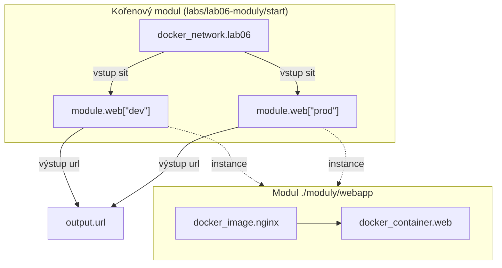

# Lab 06 – Moduly: znovupoužitelná infrastruktura

| Modul | Čas | Obtížnost | Potřebujete |
|---|---|---|---|
| [07 – Moduly](../../moduly/07-moduly/README.md) | 75 min | ★★☆ | Terraform ≥ 1.10, Docker (testy běží i bez něj) |


## Scénář
Webový kontejner z labu 03 chce použít pět týmů a každý ho potřebuje pro `dev` i `prod`. Kopírovat kód pětkrát je cesta do pekla. Z konfigurace uděláte **modul** s jasným rozhraním (vstupy a výstupy) a zavoláte ho pro každé prostředí.

## Cíle
1. **Navrhnout** modul jako „funkci“: vstupy (`variable`), tělo (zdroje), návratové hodnoty (`output`).
2. **Implementovat** modul podle předem daného rozhraní („contract first“) a ověřit ho testy modulu.
3. **Volat** modul s `for_each` a skládat jeho výstupy v kořenovém modulu.
4. **Vysvětlit**, proč modul nekonfiguruje providery a jak se moduly verzují.



---

## 1. Rozhraní je dané – implementujte modul
```bash
cd skoleni/labs/lab06-moduly/start/moduly/webapp
cat variables.tf          # kontrakt: co modul přijímá
terraform init
terraform test            # teď selže – modul ještě nic nedělá
```
Doplňte TODO 1–3 v `main.tf` a `outputs.tf` modulu, dokud `terraform test` neprojde (4 testy). Tomuto postupu se říká **test-first**: nejdřív víte, *co* má modul dělat, pak píšete *jak*.

## 2. Predict
- **P1:** Kolik zdrojů vytvoří kořenový modul se dvěma prostředími?
- **P2:** Jakou adresu bude mít kontejner pro `prod` ve stavu?
- **P3:** Co se stane, když v `variables.tf` kořenového modulu přidáte prostředí `test`?

## 3. Zavolejte modul z kořenového modulu
```bash
cd ../..                  # zpět do start/
```
Doplňte TODO 4–6 a spusťte:
```bash
terraform init            # „Initializing modules...“ – lokální modul se zaregistruje
terraform apply
terraform state list
curl -s localhost:8062 | grep h1
```

## 4. Investigate
- **I1:** Proč modul obsahuje `required_providers`, ale ne blok `provider "docker"`? Co by se stalo s `for_each` na modulu, kdyby provider konfiguroval sám?
- **I2:** Každá instance modulu má vlastní `docker_image.nginx` se stejným tagem. Je to problém? Kdy ano?
- **I3:** `docker exec lab06-dev wget -qO- http://lab06-prod` – proč to funguje?

## 5. Modify
1. Přidejte do modulu vstup `repliky` (výchozí 1) a výstup `urls` (seznam). Zachovejte zpětnou kompatibilitu – stávající volání se nesmí rozbít.
2. Přejmenujte v modulu `docker_container.web` na `docker_container.this`. Jak zajistíte, aby uživatelé modulu nepřišli o kontejnery? (Nápověda: `moved` funguje i uvnitř modulů.)

## 6. Make – verzovaný modul z Gitu
Po commitu a pushi do vašeho forku zavolejte modul přes Git s pevnou verzí:
```hcl
module "web_z_gitu" {
  source = "git::https://github.com/<vas-ucet>/terraform_repo.git//skoleni/labs/lab06-moduly/reseni/moduly/webapp?ref=main"
  # v reálném provozu ref=v1.2.0 (tag), nikdy větev
  nazev   = "lab06-git"
  port    = 8069
  titulek = "Modul z Gitu"
}
```
`terraform init` modul stáhne do `.terraform/modules/`. Proč je `ref` na tag lepší než na větev?

## 7. Ověření
```bash
terraform test                                        # kořenový modul – 3 testy
(cd moduly/webapp && terraform init && terraform test) # modul – 4 testy
```

## 8. Úklid
```bash
terraform destroy
```

## 9. Reflexe
1. Jaké vstupy by modul **neměl** mít (příliš mnoho knobů = leaky abstraction)?
2. Kdy je lepší modul z [Terraform Registry](https://registry.terraform.io/browse/modules) a kdy vlastní?
3. Jak byste modul verzovali a měnili, když ho používá 20 týmů?

---

<details>
<summary>Diskuse k předpovědím</summary>

- **P1:** 5 – síť + 2 × (image + kontejner).
- **P2:** `module.web["prod"].docker_container.web` – adresa obsahuje cestu přes modul a klíč `for_each`.
- **P3:** Přibude jedna instance modulu (2 zdroje), stávající se nezmění – díky stabilním klíčům `for_each`.
- **I1:** Moduly s vlastní konfigurací providera nelze použít s `for_each`/`count` ani bezpečně odstranit (provider by zmizel dřív než jeho zdroje). Konfigurace providerů patří do kořenového modulu.
- **I2:** V labu ne (`keep_locally = true`). Bez něj by `destroy` jedné instance smazal image, který používá druhá. Sdílené věci patří o úroveň výš a do modulu se předávají vstupem.
- **I3:** Oba kontejnery jsou ve stejné uživatelské síti; Docker v ní poskytuje DNS podle názvu kontejneru.
</details>

Referenční řešení: [`reseni/`](reseni/)
