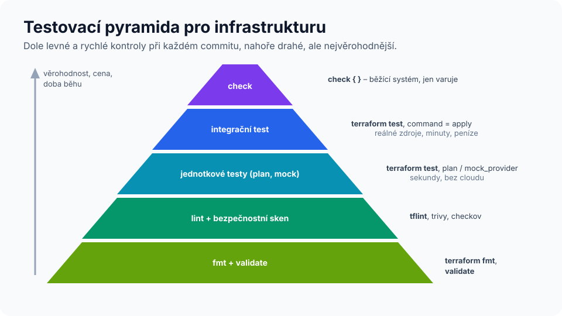

# Lab 07 – Testování a kvalita: od `fmt` po mutační testování

| Modul | Čas | Obtížnost | Potřebujete |
|---|---|---|---|
| [08 – Testování a kvalita](../../moduly/08-testovani/README.md) | 90 min | ★★★ | Terraform ≥ 1.10, Python 3 (mutační testy), volitelně TFLint a Docker |



## Scénář
Firma má jmennou konvenci `<projekt>-<d|t|p>-<komponenta>-<NN>` (např. `eshop-p-web-01`) a pět povinných štítků. Konvenci implementuje modul ve `start/` – **bez jediného providera**, je to čistá logika. Vaším úkolem je napsat testy, které hlídají, aby ji nikdo nerozbil.

Jak poznáte, že testy jsou dobré? Pokrytí kódu u Terraformu měřit nelze. Použijeme **mutační testování**: skript do modulu postupně vnese 12 drobných chyb („mutantů“) a pro každou spustí vaše testy. Pokud testy chybu nezachytí, mutant „přežil“ a víte přesně, které chování nemáte otestované.

## Cíle
1. **Zařadit** nástroje kvality do vrstev: formát → validace → lint → bezpečnostní sken → jednotkové testy → integrační testy → průběžné kontroly.
2. **Napsat** jednotkové testy v `terraform test` včetně negativních (`expect_failures`).
3. **Vyhodnotit** kvalitu testů mutačním skóre a cíleně ho zvýšit.
4. **Použít** blok `check` pro průběžné ověřování běžící infrastruktury.

---

## Část A – statická analýza (15 min)
```bash
cd skoleni/labs/lab07-testovani/start
terraform fmt -check -diff     # formát
terraform init && terraform validate
tflint --init && tflint        # lint (v Codespaces předinstalován)
```
Pak to samé spusťte nad labem 03 a zkuste bezpečnostní skener (pokud ho máte):
```bash
cd ../../lab03-docker/reseni
trivy config .        # nebo: checkov -d .
```
**Investigate:** Které nálezy jsou v kontextu lokálního labu irelevantní a které byste v produkci řešili?

## Část B – jednotkové testy a mutační skóre (50 min)
1. Prostudujte `main.tf`, `variables.tf`, `outputs.tf`. Sepište si **specifikaci**: jaké vstupy jsou platné, jaké výstupy očekáváte.
2. Spusťte výchozí stav:
   ```bash
   terraform test                 # 1 test projde
   python3 ../mutace.py           # mutační skóre ~8 %
   ```
3. Do `tests/nazvy.tftest.hcl` přidávejte `run` bloky, dokud skóre nebude **≥ 80 %**. Každý přeživší mutant vám napoví, co chybí.

Kostra pozitivního testu:
```hcl
run "nazev_prod" {
  command = plan
  variables {
    prostredi = "prod"
    instance  = 7
  }
  assert {
    condition     = output.nazev == "eshop-p-web-07"
    error_message = "Očekáván eshop-p-web-07, je ${output.nazev}."
  }
}
```
Kostra negativního testu (vstup musí být **odmítnut**):
```hcl
run "neplatne_prostredi" {
  command = plan
  variables {
    prostredi = "staging"
  }
  expect_failures = [var.prostredi]
}
```
`expect_failures` přijímá i `output.<jméno>` (precondition ve výstupu) a zdroje s `precondition`/`postcondition`.

> **Tip k návrhu testů – hraniční hodnoty:** u rozsahu 1–99 testujte 1, 99 a 100; u regexu `^[a-z]{2,10}$` testujte řetězec, který je špatný **jen** v jedné vlastnosti (např. `Es-Shop` má správnou délku, ale špatné znaky). Test se dvěma chybami najednou mutanta nezabije – i autor tohoto labu na to při přípravě narazil.

## Část C – průběžná kontrola blokem `check` (15 min)
Bloky `check` (Terraform ≥ 1.5) se vyhodnocují při každém `plan`/`apply` a **nezastaví** nasazení – jen varují. Hodí se pro *smoke testy* a detekci problémů za běhu.

Do konfigurace labu 03 přidejte provider `hashicorp/http` do `required_providers` a soubor `check.tf`:
```hcl
check "web_odpovida" {
  data "http" "web" {
    url = "http://localhost:${var.port}"
  }

  assert {
    condition     = data.http.web.status_code == 200
    error_message = "Web ${data.http.web.url} vrací ${data.http.web.status_code}."
  }
}
```
```bash
terraform init -upgrade && terraform apply
docker stop lab03-web
terraform plan -refresh-only     # Warning z bloku check, nikoli Error
```
**Investigate:** Proč je dobře, že `check` jen varuje? Kde by se taková kontrola spouštěla pravidelně? (Nápověda: plánované spouštění v CI nebo *health assessments* v HCP Terraform.)

## Část D – mock a override (bonus, 10 min)
V labech 03, 05 a 06 jste viděli `mock_provider "docker" {}`. Projděte si [dokumentaci k mockování](https://developer.hashicorp.com/terraform/language/tests/mocking) a do testů labu 06 přidejte `override_resource`, který nastaví konkrétní `id` kontejneru, a test, že ho výstup `id_kontejneru` vrací.

## Ověření
```bash
cd skoleni/labs/lab07-testovani/start
terraform test
python3 ../mutace.py        # cíl: ≥ 80 %, exit code 0
```

## Reflexe
1. Které vrstvy testovací pyramidy jste dnes použili a co každá z nich **nemůže** odhalit?
2. Jaký byl nejzajímavější přeživší mutant a jaký test ho zabil?
3. Proč jsou moduly bez providerů (čistá logika) tak vděčné na testování?

---

<details>
<summary>Diskuse</summary>

- **Pyramida:** `fmt`/`validate`/`tflint` jsou levné a běží při každém commitu, ale neznají sémantiku cloudu. Jednotkové testy s `command = plan` nebo mocky ověří logiku, ne skutečné API. Integrační testy (`command = apply` proti reálnému providerovi) jsou nejpřesnější, ale pomalé a stojí peníze. `check` bloky hlídají běžící systém.
- **Typicky přeživší mutanti:** `lower()` (stačí test s velkými písmeny v `komponenta`), `%02d` u dvouciferné instance (proto testujte i `instance = 7`), `floor()` (testujte `1.5`).
- **Mutační testování** je metoda známá z vývoje software (PIT pro Javu, Stryker pro JS/.NET, mutmut pro Python). Pro Terraform zatím neexistuje rozšířený nástroj, proto je skript v labu jednoduchý – princip je ale stejný.
</details>

Referenční testy: [`reseni/tests/nazvy.tftest.hcl`](reseni/tests/nazvy.tftest.hcl) (mutační skóre 12/12).
