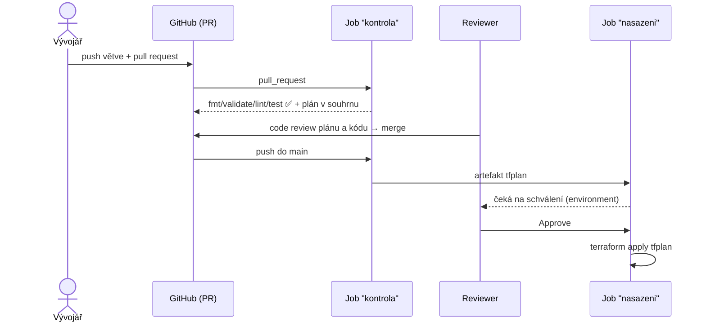

# Lab 08 – CI/CD: Terraform v GitHub Actions

| Modul | Čas | Obtížnost | Potřebujete |
|---|---|---|---|
| [09 – Týmová práce a CI/CD](../../moduly/09-tymova-prace-a-ci-cd/README.md) | 60 min | ★★☆ | Fork tohoto repozitáře na GitHubu, zapnuté GitHub Actions |


## Scénář
Nikdo z týmu už nesmí spouštět `terraform apply` z notebooku. Každá změna projde pull requestem, pipeline ji zkontroluje a ukáže plán, a do „produkce“ se nasadí až po schválení.

Infrastruktura v [`infra/`](infra/) je záměrně triviální (soubor s manifestem), aby lab běžel zdarma a bez cloudu. Pipeline je ale stejná, jakou byste použili pro AWS, Azure nebo GCP – rozdíly popisuje sekce *Do produkce*.

## Cíle
1. **Sestavit** pipeline: `fmt → init → validate → lint → test → plan → (schválení) → apply`.
2. **Zdůvodnit** `permissions`, `concurrency` a uložený plán (`-out=tfplan`).
3. **Nastavit** GitHub environment s ručním schválením jako bránu před nasazením.
4. **Popsat**, co je v produkci navíc: vzdálený backend, OIDC místo statických klíčů, policy as code.



---

## 1. Příprava
1. Udělejte si **fork** repozitáře a v záložce *Actions* workflowy povolte.
2. *Settings → Environments → New environment* `skoleni-produkce` → zapněte **Required reviewers** a přidejte sebe.
3. Lokálně ověřte, že infrastruktura projde kontrolami:
   ```bash
   cd skoleni/labs/lab08-ci-cd/infra
   terraform init && terraform fmt -check && terraform validate && terraform test
   ```

## 2. Predict
- **P1:** Proč job `nasazeni` aplikuje soubor `tfplan` z artefaktu, a ne nový `terraform apply -auto-approve`?
- **P2:** Co by se mohlo stát bez bloku `concurrency`?
- **P3:** Proč `terraform_wrapper: false`?

## 3. Doplňte pipeline
Doplňte TODO 1–7 v [`start/lab08-terraform.yml`](start/lab08-terraform.yml) a zkopírujte ho:
```bash
cp skoleni/labs/lab08-ci-cd/start/lab08-terraform.yml .github/workflows/lab08-terraform.yml
skoleni/labs/lab08-ci-cd/overeni.sh      # lokální kontrola (13 bodů), využije actionlint, pokud je k dispozici
```

## 4. Run – pipeline v akci
```bash
git switch -c lab08-zmena-verze
sed -i 's/default     = "1.0.0"/default     = "1.1.0"/' skoleni/labs/lab08-ci-cd/infra/variables.tf
git add -A && git commit -m "lab08: verze 1.1.0" && git push -u origin lab08-zmena-verze
```
Otevřete pull request **do svého forku** (`main`). Sledujte:
1. job *Kontrola a plán* – v *Summary* běhu najdete výpis plánu,
2. po merge se spustí znovu na `main` a job *Nasazení* bude čekat na vaše schválení,
3. schvalte a zkontrolujte log `terraform apply`.

## 5. Investigate
- **I1:** Rozbijte formátování (přidejte mezery do `main.tf`) a pushněte. Který krok selže a proč je dobře, že je první?
- **I2:** Nastavte `verze_aplikace = "v2"`. Ve kterém kroku pipeline chyba vypadne?
- **I3:** Proč je v `infra/` commitnutý `.terraform.lock.hcl` (v ostatních labech ho ignorujeme)? Co by se stalo, kdyby mezi jobem *kontrola* a *nasazeni* vyšla nová verze providera?
- **I4:** Kde v pipeline je **stav** (`terraform.tfstate`)? Co se s ním stane po skončení jobu?

## 6. Modify / Make
1. Přidejte job, který plán zveřejní jako **komentář v PR** (např. pomocí `actions/github-script` – pozor na `permissions: pull-requests: write` jen pro tento job).
2. Přidejte **plánovanou detekci driftu**: `schedule` (cron jednou denně) + `terraform plan -detailed-exitcode`; exit code 2 = drift → job selže a pošle notifikaci.
3. Přidejte bezpečnostní sken (`aquasecurity/trivy-action` nebo `bridgecrewio/checkov-action`).

## Do produkce – co je jinak
| Téma | Lab | Produkce |
|---|---|---|
| Stav | Lokální soubor na runneru, po jobu zmizí | Vzdálený backend (S3 + `use_lockfile`, Azure Blob, GCS, HCP Terraform) se zamykáním a verzováním |
| Přihlášení ke cloudu | Není potřeba | **OIDC** (`permissions: id-token: write`) – krátkodobé tokeny, žádné statické klíče v secrets |
| Schválení | GitHub environment | Environment + CODEOWNERS + ochrana větve `main` |
| Pravidla | `tflint`, testy | + policy as code (OPA/Conftest, Sentinel, Checkov) nad plánem v JSON (`terraform show -json tfplan`) |
| Prostředí | Jedno | Oddělené adresáře nebo stavy pro dev/test/prod, promotion stejného kódu |

## 7. Ověření
```bash
skoleni/labs/lab08-ci-cd/overeni.sh     # očekáváno: Výsledek: 13/13
```
a zelený běh workflow ve vašem forku.

## 8. Reflexe
1. Která kontrola v pipeline vám ušetří nejvíc času a proč?
2. Proč je ruční `terraform apply` z notebooku v týmu problém, i když je člověk opatrný?
3. Co by musel obsahovat plán, abyste ho jako reviewer **zamítli**?

---

<details>
<summary>Diskuse k předpovědím</summary>

- **P1:** Uložený plán zaručuje, že se provede **přesně to, co reviewer viděl**. Nový `apply` by plánoval znovu – mezitím se mohl změnit stav nebo realita. Terraform navíc odmítne aplikovat plán, pokud se stav od jeho vytvoření změnil (*stale plan*).
- **P2:** Dva souběžné běhy nad stejným stavem: druhý v lepším případě narazí na zámek, v horším (backend bez zamykání) přepíše stav prvního.
- **P3:** Wrapper z `setup-terraform` obaluje binárku a mění chování výstupu (`stdout`/`exitcode` jako outputy kroku). Pro `terraform show tfplan >> soubor` nebo `-detailed-exitcode` chceme čistou binárku.
- **I3:** Lock soubor zaručí stejné verze providerů v obou jobech i u všech kolegů. Uložený plán navíc obsahuje kontrolní součty providerů – kdyby `init` v jobu *nasazeni* stáhl jinou verzi, `apply tfplan` by odmítl pokračovat. Lock soubor obsahuje hashe `zh:` pro všechny platformy (Linux, macOS, Windows), proto funguje kdekoli.
- **I4:** V labu stav vznikne na runneru a po jobu zanikne – každé nasazení začíná „od nuly“. Právě proto produkce potřebuje vzdálený backend.
</details>

Referenční řešení: [`reseni/lab08-terraform.yml`](reseni/lab08-terraform.yml) · Celý kurz se kontroluje obdobnou pipeline: [`.github/workflows/skoleni-ci.yml`](../../../.github/workflows/skoleni-ci.yml)
