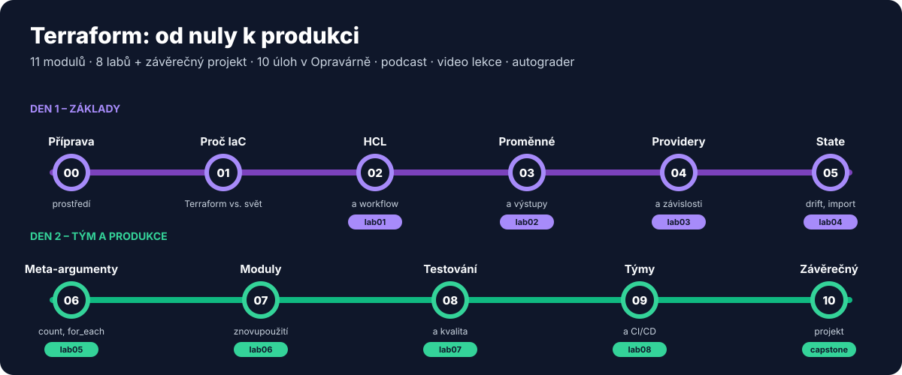
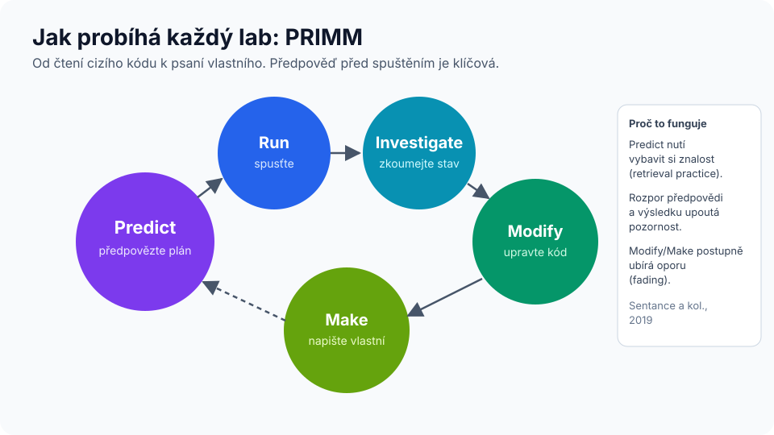

# Modul 00 – Příprava prostředí a jak se v kurzu učit

| Délka | Podcast | Lab |
|---|---|---|
| 30 min (před kurzem) | 🎧 [Ep. 00 – Jak se v kurzu učit](../../podcast/ep00-jak-se-ucit.md) | kontrola prostředí |

## Cíle
Po tomto modulu:
1. máte funkční prostředí (Terraform ≥ 1.10, Docker, Git, volitelně TFLint a Python 3),
2. víte, jak je kurz postavený a **proč** – co dělat před lekcí, během ní a po ní.

---

## 1. Prostředí – zvolte jednu cestu

### A) GitHub Codespaces (doporučeno, nic neinstalujete)
[](https://codespaces.new/ravisileb/terraform_repo)

Repozitář obsahuje [`.devcontainer/devcontainer.json`](../../../.devcontainer/devcontainer.json): Terraform, TFLint, terraform-docs, Docker (docker-in-docker), Python a rozšíření VS Code pro HCL. Po startu se automaticky spustí kontrola prostředí. Ve forku použijte tlačítko *Code → Codespaces → Create codespace*.

> Codespaces mají měsíční bezplatnou kvótu pro osobní účty (aktuální limity viz [dokumentace GitHubu](https://docs.github.com/en/billing/managing-billing-for-your-products/managing-billing-for-github-codespaces/about-billing-for-github-codespaces)). Po kurzu codespace zastavte nebo smažte.

### B) Lokální instalace
| Nástroj | Instalace | Ověření |
|---|---|---|
| Terraform ≥ 1.10 | <https://developer.hashicorp.com/terraform/install> (macOS: `brew install hashicorp/tap/terraform`, Windows: `winget install Hashicorp.Terraform`) | `terraform version` |
| Docker | Docker Desktop, Colima, Rancher Desktop nebo Docker Engine | `docker info` |
| Git | <https://git-scm.com> | `git --version` |
| TFLint *(lab 07)* | <https://github.com/terraform-linters/tflint> | `tflint --version` |
| Python 3 *(lab 07)* | <https://www.python.org> | `python3 --version` |

Doporučený editor: VS Code s rozšířením **HashiCorp Terraform** (doplňování, validace, formátování při uložení).

### Kontrola
```bash
git clone https://github.com/<vas-ucet>/terraform_repo.git
cd terraform_repo
./skoleni/nastroje/overeni-prostredi.sh
```
Očekáváno: všechny řádky ✅ (⚠️ u volitelných nástrojů nevadí).

<details>
<summary>Můžu použít OpenTofu místo Terraformu?</summary>

Ano, s výhradami. OpenTofu je komunitní fork Terraformu (licence MPL 2.0). Laby 01–08 používají vlastnosti, které OpenTofu má také (`terraform test`/`tofu test`, `import`, `moved`, `removed`, mock providery). Příkazy pište jako `tofu …`. Rozdíly se mohou objevit v novějších funkcích a ve výpisech. Viz [modul 01](../01-proc-iac/README.md#terraform-a-opentofu).
</details>

---

## 2. Jak je kurz postavený


Každý modul má stejný rytmus:

| Kdy | Co | Proč (podrobně v [METODIKA.md](../../METODIKA.md)) |
|---|---|---|
| **Před lekcí** (15 min) | 🎧 podcast + 🎬 krátké video | Dvojí kódování (zvuk + obraz) a předaktivace pojmů. Lekce pak může jít do praxe. |
| **Začátek lekce** (5 min) | Rozcvička – 3 otázky z *minulých* modulů, bez poznámek | **Vybavování** (retrieval practice) a **rozložené opakování** posilují paměť víc než opětovné čtení. |
| **Lekce** (20 min) | Krátký výklad s diagramy | Jen to, co je nutné pro lab. |
| **Lab** (45–90 min) | PRIMM: předpověď → spuštění → zkoumání → úprava → vlastní tvorba | Aktivní učení; předpověď před spuštěním odhalí mylné představy. |
| **Konec lekce** (5 min) | Kvíz + reflexe („exit ticket“) | Okamžitá zpětná vazba a metakognice. |
| **Po lekci** (5 min denně) | Kartičky v Anki | Rozložené opakování v čase. |



### Pravidla, která se vyplatí dodržet
1. **Předpovídejte nahlas nebo písemně.** I špatná předpověď pomáhá – rozpor s realitou si zapamatujete.
2. **Nápovědy otevírejte až po minutě vlastního přemýšlení.** Úsilí při vybavování je součást učení, ne překážka.
3. **Nečtěte řešení „pro kontrolu“ předem.** Spusťte testy (`terraform test`, `zkontroluj.sh`) – ty vám řeknou, jestli je hotovo.
4. **Opakujte rozloženě.** Kartičky 5 minut denně > hodina jednou za týden.

### Kartičky (Anki)
Stáhněte [`karticky/terraform-karticky.tsv`](../../karticky/terraform-karticky.tsv) a importujte do [Anki](https://apps.ankiweb.net/) (*Soubor → Importovat*, oddělovač tabulátor, pole 1 = přední strana, pole 2 = zadní strana, pole 3 = štítky). Každá kartička má štítek modulu (`m02` …), takže můžete opakovat jen probrané moduly.

### Autograder
```bash
./skoleni/nastroje/zkontroluj.sh lab01          # jeden lab
./skoleni/nastroje/zkontroluj.sh vse            # přehled všech labů
```
Ve vašem forku se po každém pushi spustí GitHub Actions workflow a v *Summary* uvidíte tabulku splněných labů.

---

## Kvíz
1. Proč kurz začíná každou lekci otázkami z *předchozích* modulů?
2. Co je první krok cyklu PRIMM a proč je důležitý?
3. Kde zjistíte, zda je lab hotový?

<details>
<summary>Odpovědi</summary>

1. Vybavování z paměti s časovým odstupem (retrieval practice + spacing) patří k technikám s nejsilnější empirickou podporou (Dunlosky a kol., 2013). Opětovné čtení má podle stejné přehledové studie nízkou účinnost.
2. *Predict* – předpověď výsledku před spuštěním. Nutí aktivovat znalost a zviditelní mylné představy.
3. `terraform test` v adresáři labu nebo `./skoleni/nastroje/zkontroluj.sh labNN`.
</details>

➡️ Pokračujte modulem [01 – Proč infrastruktura jako kód](../01-proc-iac/README.md)
