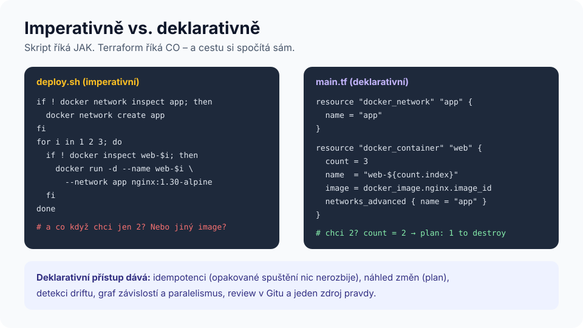
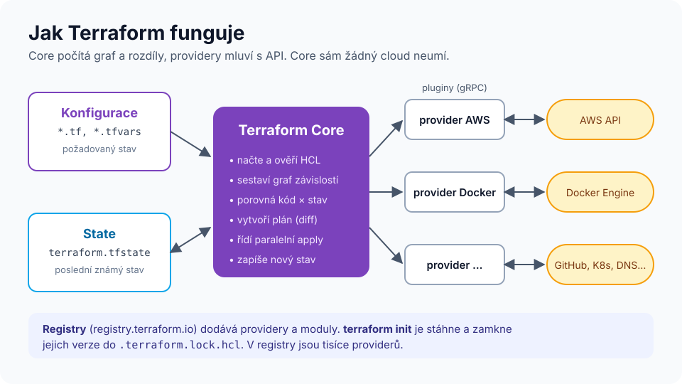

# Modul 01 – Proč infrastruktura jako kód

| Délka | Podcast | Video | Lab |
|---|---|---|---|
| 45 min | 🎧 [Ep. 01 – Proč infrastruktura jako kód](../../podcast/ep01-proc-infrastruktura-jako-kod.md) | 🎬 [Lekce 01 – Jak funguje Terraform](../../video/README.md#lekce-01) | – (diskusní aktivita) |

## Cíle
1. **Vysvětlit** problémy ruční správy infrastruktury („ClickOps“) a jak je IaC řeší.
2. **Rozlišit** imperativní a deklarativní přístup a vysvětlit idempotenci.
3. **Popsat** architekturu Terraformu: Core, providery, stav, registry.
4. **Porovnat** Terraform s alternativami a **rozhodnout**, kdy Terraform (ne)použít.

## Rozcvička (bez poznámek, 3 min)
Napište na papír, jak jste naposledy vytvářeli server, databázi nebo DNS záznam. Kolik kroků to bylo? Uměli byste to zopakovat přesně stejně za půl roku? Kdo jiný by to zvládl?

---

## 1. Problém: ruční infrastruktura
Infrastruktura vytvořená klikáním v konzoli nebo ad-hoc skripty má typické vady:

| Problém | Projev |
|---|---|
| **Sněhové vločky** (snowflake servers) | Každý server je trochu jiný, nikdo neví proč. |
| **Configuration drift** | Prostředí `test` a `prod` se postupně rozcházejí. |
| **Chybí audit** | Kdo, kdy a proč změnil pravidlo firewallu? |
| **Nereprodukovatelnost** | Obnova po havárii = archeologie. |
| **Znalost v hlavách** | „Na to se zeptej Petra.“ Petr je na dovolené. |

**Infrastruktura jako kód (IaC)** znamená popsat infrastrukturu v textových souborech, které se verzují v Gitu, procházejí code review a automaticky se aplikují. Na infrastrukturu se tím přenesou postupy, které se osvědčily ve vývoji software.

> **Co říkají data.** Výzkumný program DORA (Forsgren, Humble a Kim: *Accelerate*, 2018, a každoroční zprávy *State of DevOps*) dlouhodobě nachází souvislost mezi automatizací nasazení, správou verzí všech artefaktů a lepšími výsledky doručování software (frekvence nasazení, doba obnovy, míra chyb). **Míra jistoty:** konzistentní, ale jde o průzkumová, korelační data – kauzalitu nedokazují a samotné IaC není jediná proměnná.

## 2. Imperativně vs. deklarativně

- **Imperativní** přístup popisuje *kroky* (vytvoř síť, pokud neexistuje; spusť 3 kontejnery…). Každý okrajový případ musíte ošetřit sami.
- **Deklarativní** přístup popisuje *cílový stav* („chci síť a 3 kontejnery“). Nástroj zjistí, co existuje, a spočítá rozdíl.

**Idempotence:** opakované spuštění se stejným vstupem vede ke stejnému výsledku. `terraform apply` bez změny kódu nic nezmění – plán je prázdný. To je vlastnost, kterou si v labu 01 ověříte.

## 3. Jak Terraform funguje

- **Terraform Core** (jeden binární soubor) načte konfiguraci v jazyce **HCL**, sestaví **graf závislostí**, porovná požadovaný stav se **stavem** (*state*) a vytvoří **plán**.
- **Providery** jsou pluginy (samostatné procesy komunikující přes gRPC), které znají konkrétní API: AWS, Azure, Google Cloud, Kubernetes, GitHub, Docker, Cloudflare, Datadog… Core sám žádné API nezná.
- **State** je soubor (nebo objekt ve vzdáleném úložišti), kde si Terraform pamatuje, které reálné objekty patří ke kterým zdrojům v kódu. Bez něj by nevěděl, co spravuje. Podrobně v [modulu 05](../05-state/README.md).
- **Registry** (<https://registry.terraform.io>) distribuuje providery a moduly.

## 4. Terraform a alternativy
| Nástroj | Přístup | Jazyk | Rozsah | Kdy zvážit |
|---|---|---|---|---|
| **Terraform** | deklarativní, stav ve vlastním souboru | HCL | multi-cloud + SaaS | výchozí volba pro většinu týmů |
| **OpenTofu** | jako Terraform (fork) | HCL | totéž | otevřená licence MPL 2.0, komunitní governance |
| **Pulumi** | deklarativní, programově | TypeScript, Python, Go, C#, Java | multi-cloud | tým preferuje obecný programovací jazyk |
| **AWS CloudFormation / CDK** | deklarativní, stav spravuje AWS | YAML/JSON, CDK v TS/Python… | jen AWS | čistě AWS prostředí |
| **Azure Bicep** | deklarativní, stav spravuje Azure | Bicep | jen Azure | čistě Azure prostředí |
| **Crossplane** | Kubernetes kontrolery (kontinuální rekonciliace) | YAML (K8s CRD) | multi-cloud | platformní týmy postavené na Kubernetes |
| **Ansible** | převážně procedurální playbooky, idempotentní moduly | YAML | konfigurace OS a aplikací | konfigurace serverů; s Terraformem se často kombinuje |

**Typická dělba práce:** Terraform vytvoří infrastrukturu (sítě, VM, databáze, DNS), konfigurační nástroj nebo image (Ansible, cloud-init, Packer, kontejnery) se postará o obsah strojů.

### Terraform a OpenTofu
- **Fakta:** V srpnu 2023 HashiCorp změnil licenci Terraformu z MPL 2.0 na **Business Source License 1.1** (od verze 1.6). Komunita vytvořila fork **OpenTofu** pod Linux Foundation (první stabilní verze 1.6.0 v lednu 2024). Společnost **IBM** dokončila akvizici HashiCorpu v únoru 2025.
- **Prakticky:** Pro koncové uživatele, kteří Terraform používají ke správě vlastní infrastruktury, BSL obvykle nic nemění; omezení se týká především nabízení konkurenčních komerčních služeb. **Míra jistoty:** výklad licencí je právní otázka – pro firemní rozhodnutí se poraďte s právním oddělením.
- **Kompatibilita:** Základní jazyk a workflow jsou shodné. Od roku 2024 se projekty rozcházejí v nových funkcích (např. OpenTofu má šifrování stavu, Terraform má *ephemeral* zdroje a *Stacks* v HCP). Tento kurz používá Terraform; principy platí pro oba.

## 5. Kdy Terraform **ne**
- Jednorázový experiment, který za hodinu smažete (klidně klikejte – ale nedělejte z toho produkci).
- Konfigurace uvnitř OS (balíčky, soubory) – na to jsou lepší nástroje (Ansible, cloud-init, image).
- Vysoce dynamické objekty s životností sekund (pody, joby) – to je práce orchestrátoru (Kubernetes).
- Data uvnitř databází (uživatelé aplikace, záznamy) – Terraform spravuje infrastrukturu, ne obsah.

---

## Aktivita (15 min, ve dvojicích): „Rekonstrukce“
Vezměte proces z rozcvičky a:
1. sepište ho jako **imperativní** postup (kroky),
2. přepište ho jako **deklaraci** cílového stavu (co má existovat, s jakými vlastnostmi),
3. najděte aspoň dvě situace, kdy imperativní postup selže a deklarace ne (např. spuštění podruhé, částečně existující prostředí).

## Shrnutí
1. IaC = infrastruktura v textu, verzovaná, revidovaná a automaticky aplikovaná.
2. Deklarativní přístup + idempotence = stejný kód → stejný výsledek, kolikrát chcete.
3. Terraform Core počítá graf a plán, providery mluví s API, state páruje kód s realitou.
4. Volba nástroje závisí na prostředí a týmu; Terraform je de facto standard pro multi-cloud.
5. Terraform není na všechno – konfigurace OS, krátkodobé objekty a data aplikací patří jinam.

## Kvíz
1. Co znamená, že je `terraform apply` idempotentní?
2. Která komponenta Terraformu ví, jak vytvořit S3 bucket: Core, provider, nebo state?
3. Kolega tvrdí: „State je jen cache, můžu ho smazat, Terraform si to zjistí.“ Má pravdu?
4. Uveďte dva rozdíly mezi Terraformem a AWS CloudFormation.
5. Je Ansible deklarativní, nebo imperativní? (Pozor, chyták.)
6. Proč nevyužívat Terraform ke správě uživatelů *uvnitř* aplikační databáze?

Odpovědi

1. Opakované spuštění bez změny vstupů nevede k žádné další změně; Terraform porovná cílový stav se skutečným a nenajde rozdíl.
2. Provider (AWS). Core zná jen graf, plán a stav.
3. Ne. State obsahuje mapování „zdroj v kódu ↔ ID reálného objektu“. Bez něj Terraform neví, které objekty spravuje, a pokusil by se vše vytvořit znovu (kolize nebo duplicity). Proto se state zálohuje a verzuje.
4. Např.: CloudFormation je jen pro AWS, Terraform pro mnoho platforem; stav CloudFormation spravuje AWS (stack), Terraform má vlastní state; jazyk YAML/JSON vs. HCL.
5. Obojí – playbook je sekvence úloh (procedurální), ale jednotlivé moduly jsou navržené idempotentně a deklarují cílový stav (např. „balíček je nainstalován“). Odborná literatura ho proto řadí různě.
6. Jde o data aplikace s vlastním životním cyklem; změny mimo Terraform by vytvářely neustálý drift a state by obsahoval citlivá data. Infrastrukturu (instanci, síť, zálohy) ano, obsah ne.

## Zdroje
- [What is Infrastructure as Code with Terraform?](https://developer.hashicorp.com/terraform/tutorials/aws-get-started/infrastructure-as-code) – HashiCorp
- [OpenTofu – dokumentace](https://opentofu.org/docs/)
- Forsgren, N., Humble, J., Kim, G. (2018). *Accelerate: The Science of Lean Software and DevOps.* IT Revolution.
- Morris, K. (2020). *Infrastructure as Code*, 2. vyd. O'Reilly.

➡️ Další: [02 – HCL a workflow](../02-hcl-a-workflow/README.md)
