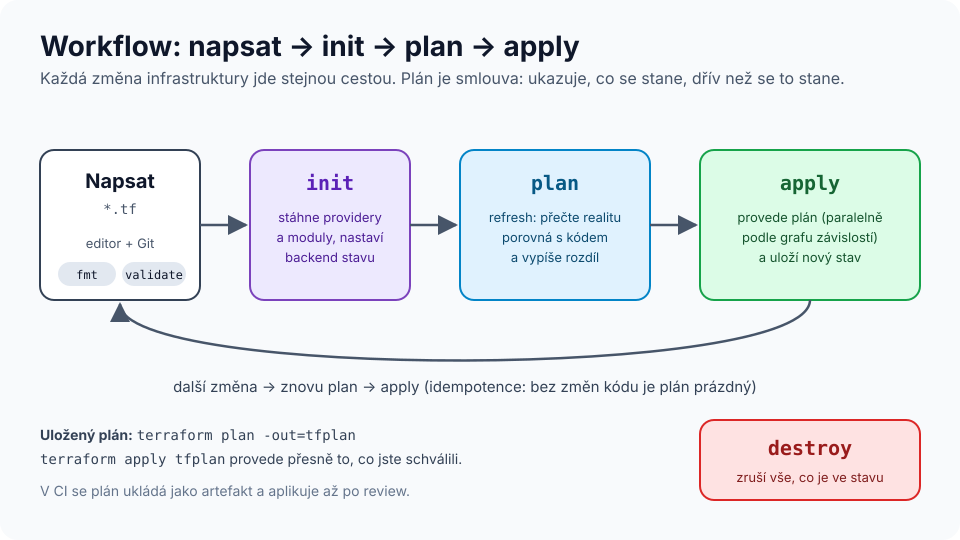
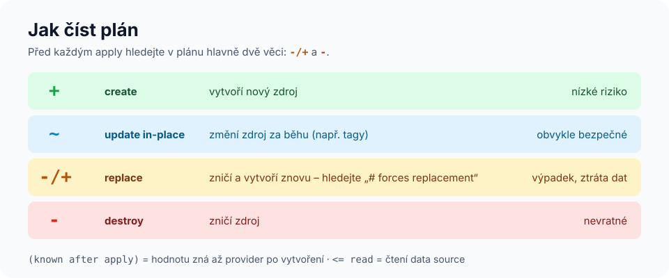

# Modul 02 – HCL a základní workflow

| Délka | Podcast | Video | Lab |
|---|---|---|---|
| 90 min | 🎧 [Ep. 02 – HCL a workflow](../../podcast/ep02-hcl-a-workflow.md) | 🎬 [Lekce 02 – Workflow a plán](../../video/README.md#lekce-02) | 🧪 [Lab 01 – První kroky](../../labs/lab01-prvni-kroky/README.md) |

## Cíle
1. **Přečíst a napsat** základní bloky HCL: `terraform`, `provider`, `resource`, `data`, `variable`, `output`, `locals`.
2. **Provést** workflow `init → plan → apply → destroy` a **vysvětlit**, co každý krok dělá.
3. **Interpretovat** výpis plánu (symboly `+ ~ -/+ -`, `known after apply`).
4. **Zdůvodnit**, proč se commituje `.terraform.lock.hcl` a necommituje `terraform.tfstate`.

## Rozcvička (z modulu 01)
1. Co je idempotence?
2. Co dělá provider a co Terraform Core?
3. Jmenujte jednu situaci, kdy Terraform nepoužít.

---

## 1. Anatomie HCL
```hcl
# blok    typ zdroje       lokální jméno
resource "local_file"     "pozdrav" {
  filename = "${path.module}/pozdrav.txt"   # argument = výraz
  content  = "Ahoj, ${random_pet.jmeno.id}" # reference na jiný zdroj

  lifecycle {                               # vnořený blok
    prevent_destroy = false
  }
}
```
- **Blok** má typ (`resource`), návěští (`"local_file" "pozdrav"`) a tělo `{ … }`.
- **Argument** přiřazuje hodnotu: řetězec, číslo, bool, seznam `[…]`, mapa `{…}` nebo **výraz**.
- **Reference** `TYP.JMÉNO.ATRIBUT` (`random_pet.jmeno.id`) vytváří závislost.
- **Interpolace** `"${…}"` vkládá výraz do řetězce.
- Komentáře: `#` nebo `//`, víceřádkové `/* … */`.
- Pořadí bloků a souborů **nehraje roli** – Terraform načte všechny `*.tf` v adresáři jako jeden modul a pořadí určí z grafu.

### Typy bloků v kostce
| Blok | Účel | Příklad adresy |
|---|---|---|
| `terraform` | verze Terraformu, providery, backend | – |
| `provider` | konfigurace providera (region, přihlášení) | – |
| `resource` | spravovaný objekt – Terraform ho vytváří, mění, maže | `local_file.pozdrav` |
| `data` | jen čtení existujícího objektu | `data.local_file.sablona` |
| `variable` | vstup modulu | `var.prostredi` |
| `locals` | pojmenované mezivýpočty | `local.plny_nazev` |
| `output` | výstup modulu | `output.url` |
| `module` | volání jiného modulu | `module.web` |

### Konvence souborů
```
main.tf        # zdroje
variables.tf   # vstupy
outputs.tf     # výstupy
versions.tf    # blok terraform {} + provider {}
terraform.tfvars / *.auto.tfvars   # hodnoty proměnných
```
Konvence, ne pravidlo – ale dodržujte ji, ostatní se v kódu rychleji zorientují.

## 2. Workflow


| Příkaz | Co dělá | Mění realitu? |
|---|---|---|
| `terraform init` | stáhne providery a moduly do `.terraform/`, vytvoří/ověří `.terraform.lock.hcl`, inicializuje backend | ne |
| `terraform fmt` | kanonické formátování | ne (jen soubory) |
| `terraform validate` | syntaxe, typy, reference vůči schématu providerů | ne |
| `terraform plan` | refresh + výpočet rozdílu | ne |
| `terraform apply` | plán + potvrzení + provedení + zápis stavu | **ano** |
| `terraform destroy` | plán zrušení všeho ve stavu | **ano** |

<details>
<summary>🎬 Záznam workflow v terminálu – po labu 01 (otevřete až po vlastním spuštění)</summary>


</details>

## 3. Jak číst plán


```text
  # local_file.pozdrav must be replaced
-/+ resource "local_file" "pozdrav" {
      ~ content  = <<-EOT # forces replacement
          - Ahoj, jsem kind-kodiak!
          + Čau, já jsem kind-kodiak!
        EOT
      ~ id       = "4f7c…" -> (known after apply)
        # (3 unchanged attributes hidden)
    }

Plan: 1 to add, 0 to change, 1 to destroy.
```
- `# forces replacement` – argument, který nelze změnit za běhu; zdroj se zničí a vytvoří znovu.
- `(known after apply)` – hodnotu zná až provider po vytvoření (ID, IP adresa, vygenerované jméno).
- **Zvyk profesionálů:** v každém plánu nejdřív najít řádek `Plan:` a všechny `-/+` a `-`. Teprve pak číst detaily.

## 4. Lock soubor vs. state
| Soubor | Obsah | Do Gitu? |
|---|---|---|
| `.terraform.lock.hcl` | přesné verze a kontrolní součty providerů | **ano** – reprodukovatelné buildy, ochrana dodavatelského řetězce |
| `.terraform/` | stažené providery a moduly | ne (cache) |
| `terraform.tfstate` | stav infrastruktury, často **s tajemstvími** | **ne** – patří do vzdáleného backendu ([modul 05](../05-state/README.md)) |

> V labech kurzu lock soubor ignorujeme (každý si ho vytvoří sám při `init`); výjimkou je lab 08, kde ho pipeline potřebuje. V reálném projektu ho **vždy** commitujte.

## 5. Omezení verzí
```hcl
terraform {
  required_version = ">= 1.10"
  required_providers {
    random = {
      source  = "hashicorp/random"   # <namespace>/<typ> v registry
      version = "~> 3.6"             # >= 3.6.0, < 4.0.0
    }
  }
}
```
`~>` („pesimistický operátor“) povolí jen zvýšení **poslední uvedené** složky: `~> 3.6` = 3.x od 3.6, `~> 3.6.1` = 3.6.x od 3.6.1.

---

## Shrnutí
1. HCL = bloky, argumenty, výrazy; pořadí nehraje roli, rozhoduje graf.
2. `init` připraví pracovní adresář, `plan` ukáže rozdíl, `apply` ho provede.
3. V plánu hledejte nejdřív `-/+` a `-` – to jsou potenciální výpadky.
4. Lock soubor do Gitu, state nikdy.
5. Verze providerů pinujte (`~>`) – reprodukovatelnost.

## Kvíz
1. Proč Terraformu nezáleží na pořadí bloků v souboru?
2. Co znamená `~> 2.5` a co `~> 2.5.0`?
3. Plán ukazuje `-/+` u databáze. Co uděláte, než napíšete `yes`?
4. Který příkaz zjistí překlep v názvu atributu bez přístupu k cloudu?
5. Co se stane při druhém `terraform apply` bez změny kódu?
6. Proč nepoužívat `timestamp()` v argumentu zdroje?

<details>
<summary>Odpovědi</summary>

1. Pořadí vytváření určuje graf závislostí sestavený z referencí, ne pořadí v textu.
2. `~> 2.5` = `>= 2.5, < 3.0`; `~> 2.5.0` = `>= 2.5.0, < 2.6.0`.
3. Zjistím, který argument vynucuje náhradu (`# forces replacement`), zda změnu opravdu chci, a jestli existuje alternativa (jiný argument, `moved`, `lifecycle`, migrace dat). Náhrada databáze = ztráta dat.
4. `terraform validate` (kontroluje reference vůči schématu providera).
5. Nic – „No changes. Your infrastructure matches the configuration.“
6. Vyhodnotí se při každém plánu jinak, takže plán nebude nikdy prázdný (trvalý „falešný“ rozdíl). Pro jednorázový čas použijte `time_static`.
</details>

## Zdroje
- [Terraform language – Syntax](https://developer.hashicorp.com/terraform/language/syntax/configuration)
- [Dependency lock file](https://developer.hashicorp.com/terraform/language/files/dependency-lock)
- [Version constraints](https://developer.hashicorp.com/terraform/language/expressions/version-constraints)

➡️ Lab: [Lab 01 – První kroky](../../labs/lab01-prvni-kroky/README.md) · Další modul: [03 – Proměnné a výstupy](../03-promenne-a-vystupy/README.md)
