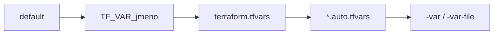

# Modul 03 – Proměnné, výstupy, výrazy a citlivá data

| Délka | Podcast | Video | Lab |
|---|---|---|---|
| 90 min | 🎧 [Ep. 03 – Proměnné a výstupy](../../podcast/ep03-promenne-a-vystupy.md) | 🎬 [Lekce 03 – Proměnné](../../video/README.md#lekce-03) | 🧪 [Lab 02 – Proměnné](../../labs/lab02-promenne/README.md) |

## Cíle
1. **Deklarovat** proměnné s typy a validacemi, včetně validací mezi proměnnými.
2. **Rozhodnout**, kdy použít `variable`, `locals` a `output`.
3. **Psát** výrazy: šablony řetězců, podmínky, `for`, funkce, `templatefile`.
4. **Vysvětlit** rozdíl mezi `sensitive`, `ephemeral` a *write-only* argumenty a jejich vztah ke stavu.

## Rozcvička
1. Co znamená v plánu `-/+`?
2. Proč se commituje `.terraform.lock.hcl`?
3. Který příkaz stáhne providery?

---

## 1. Vstupy, mezivýpočty, výstupy
Modul si představte jako **funkci**: proměnné jsou parametry, `locals` lokální proměnné, výstupy návratové hodnoty.

```hcl
variable "prostredi" {
  description = "Cílové prostředí."
  type        = string
  default     = "dev"

  validation {
    condition     = contains(["dev", "test", "prod"], var.prostredi)
    error_message = "prostredi musí být dev, test nebo prod."
  }
}

locals {
  plny_nazev = "${var.aplikace}-${var.prostredi}"
}

output "plny_nazev" {
  value       = local.plny_nazev
  description = "Název použitý pro všechny zdroje."
}
```

### Typový systém
| Typ | Příklad | Poznámka |
|---|---|---|
| `string`, `number`, `bool` | `"eshop"`, `3`, `true` | primitivní typy |
| `list(string)` | `["a", "b"]` | pořadí, duplicity povoleny |
| `set(string)` | `toset(["a", "b"])` | bez pořadí a duplicit – vhodné pro `for_each` |
| `map(number)` | `{ web = 80, api = 8080 }` | klíče jsou řetězce |
| `object({...})` | `{ port = number, tls = optional(bool, false) }` | pevná struktura, `optional()` s výchozí hodnotou |
| `tuple([...])` | `[string, number]` | pevná délka a typy |
| `any` | – | vyhněte se mu ve veřejných modulech |

Terraform provádí **automatické konverze**, kde jsou jednoznačné (`"3"` → `3`). Explicitní typy chytí chybu na vstupu, ne hluboko v konfiguraci.

### Validace
- `validation` v proměnné: podmínka musí vrátit `true`, jinak se vypíše `error_message`. Od Terraformu **1.9** může podmínka odkazovat i na **jiné proměnné**:
  ```hcl
  validation {
    condition     = var.prostredi != "prod" || var.pocet_replik >= 2
    error_message = "V prod musí běžet alespoň 2 repliky."
  }
  ```
- `precondition`/`postcondition` v `lifecycle` zdroje nebo ve výstupu – kontroly během plánu/apply ([modul 06](../06-meta-argumenty/README.md)).

## 2. Odkud se berou hodnoty

Pozdější přepisuje dřívější. Proměnná bez `default` je **povinná** – Terraform se zeptá, nebo (v CI s `-input=false`) skončí chybou.

## 3. Výrazy, které budete používat denně
```hcl
"${var.a}-${var.b}"                                # šablona řetězce
var.prod ? 3 : 1                                   # podmínka (obě větve stejný typ!)
[for p in var.porty : "port-${p}"]                 # for → seznam
{ for k, v in var.stitky : upper(k) => v }         # for → mapa
[for s in var.sluzby : s.nazev if s.zapnuto]       # filtr
merge(local.vychozi, var.stitky)                   # sloučení map (poslední vyhrává)
lookup(var.velikosti, var.prostredi, "small")      # mapa s výchozí hodnotou
coalesce(var.nazev, "vychozi")                     # první ne-null/neprázdná hodnota
try(var.config.tls.port, 443)                      # bezpečný přístup
templatefile("${path.module}/app.tftpl", { porty = var.porty })
```
Interaktivní hřiště: `terraform console` – zkoušejte výrazy proti skutečné konfiguraci.

Šablony (`*.tftpl`) podporují direktivy:
```text
%{ for p in porty ~}
listen 0.0.0.0:${p}
%{ endfor ~}
```
`~` odstraní bílé znaky (nový řádek) vedle direktivy.

## 4. Citlivá data – co Terraform umí a co ne
| Mechanismus | Od verze | Skryje ve výpisu | Uloží do stavu/plánu |
|---|---|---|---|
| `sensitive = true` (výstup; proměnná od 0.14) | dlouho | ✅ | ⚠️ **ano, v čitelné podobě** |
| `ephemeral = true` (proměnná, výstup) | 1.10 | ✅ | ✅ ne – hodnota existuje jen během běhu |
| `ephemeral` zdroje (např. dočasné tajemství z Vaultu) | 1.10 | ✅ | ✅ ne |
| *write-only* argumenty (např. `password_wo`) | 1.11 | ✅ | ✅ ne – provider hodnotu přijme, ale neukládá |

```hcl
variable "db_heslo" {
  type      = string
  ephemeral = true     # nesmí skončit ve stavu
}

resource "aws_db_instance" "db" {
  # …
  password_wo         = var.db_heslo     # write-only argument
  password_wo_version = 1                # změnou verze vynutíte rotaci
}
```
Write-only argumenty musí podporovat konkrétní provider a zdroj. **Pravidlo:** dokud tajemství prochází běžným argumentem, je ve stavu – chraňte stav jako tajemství (šifrovaný backend, řízený přístup).

---

## Shrnutí
1. `variable` = vstup, `locals` = mezivýpočet, `output` = výstup.
2. Typy a validace zachytí chyby na vstupu; validace mezi proměnnými od 1.9.
3. Pořadí přednosti: default < `TF_VAR_` < `terraform.tfvars` < `*.auto.tfvars` < `-var`/`-var-file`.
4. `for`, `merge`, `templatefile`, `try` a `terraform console` pokryjí většinu potřeb.
5. `sensitive` jen skrývá výpis; ve stavu je hodnota dál. `ephemeral` a write-only ne.

## Kvíz
1. Máte `default = "dev"` a `TF_VAR_prostredi=prod` a spustíte `terraform plan -var prostredi=test`. Jaká hodnota platí?
2. Proč `var.x ? [1, 2] : "a"` neprojde?
3. Napište výraz, který z `["web", "api"]` vytvoří mapu `{ web = "web.local", api = "api.local" }`.
4. Výstup vrací hodnotu z citlivé proměnné bez `sensitive = true`. Co udělá Terraform?
5. Kde všude může být tajemství předané běžným argumentem zdroje?
6. Kdy byste zvolili `set(string)` místo `list(string)`?

<details>
<summary>Odpovědi</summary>

1. `test` – `-var` má nejvyšší prioritu.
2. Obě větve podmíněného výrazu musí mít stejný (sjednotitelný) typ; seznam a řetězec nejde sjednotit.
3. `{ for s in ["web", "api"] : s => "${s}.local" }`
4. Skončí chybou „Output refers to sensitive values“ – citlivost se šíří a výstup ji musí explicitně přiznat.
5. Ve stavu, v uloženém plánu (`-out`), v logu providera při ladění (`TF_LOG`) a samozřejmě v proměnných prostředí/CI, odkud přišlo.
6. Když nezáleží na pořadí a prvky jsou jedinečné identifikátory – typicky jako vstup pro `for_each`.
</details>

## Zdroje
- [Input variables](https://developer.hashicorp.com/terraform/language/values/variables) · [Output values](https://developer.hashicorp.com/terraform/language/values/outputs) · [Local values](https://developer.hashicorp.com/terraform/language/values/locals)
- [Expressions](https://developer.hashicorp.com/terraform/language/expressions) · [Built-in functions](https://developer.hashicorp.com/terraform/language/functions)
- [Ephemeral values in Terraform](https://www.hashicorp.com/blog/ephemeral-values-in-terraform) · [Write-only arguments](https://developer.hashicorp.com/terraform/language/resources/ephemeral/write-only)

➡️ Lab: [Lab 02 – Proměnné](../../labs/lab02-promenne/README.md) · Další modul: [04 – Providery a závislosti](../04-providery-a-zavislosti/README.md)
