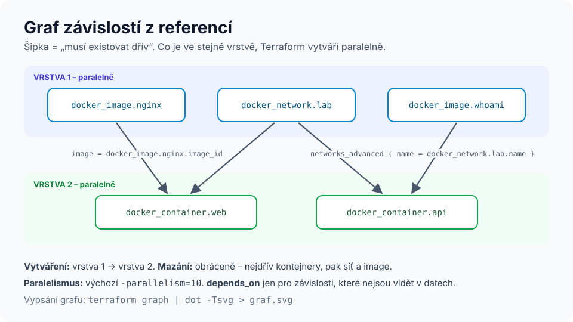
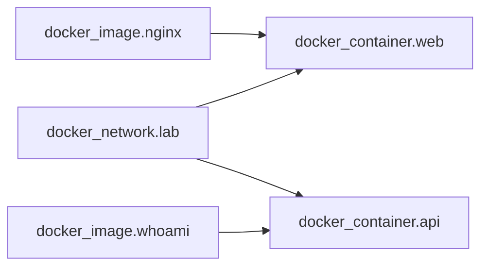

# Modul 04 – Providery, zdroje, datové zdroje a graf závislostí

| Délka | Podcast | Video | Lab |
|---|---|---|---|
| 90 min | 🎧 [Ep. 04 – Providery a závislosti](../../podcast/ep04-providery-a-zavislosti.md) | 🎬 [Lekce 04 – Graf závislostí](../../video/README.md#lekce-04) | 🧪 [Lab 03 – Docker](../../labs/lab03-docker/README.md) |

## Cíle
1. **Nakonfigurovat** provider, pinovat jeho verzi a použít více konfigurací (`alias`).
2. **Rozlišit** `resource` a `data` a **použít** datový zdroj.
3. **Vysvětlit**, jak z referencí vzniká graf a kdy je nutné `depends_on`.
4. **Předpovědět**, kdy změna argumentu povede k náhradě zdroje.

## Rozcvička
1. Jaký je rozdíl mezi `variable` a `locals`?
2. Proč `sensitive = true` nestačí k ochraně tajemství?
3. Co znamená `~> 4.0`?

---

## 1. Provider: plugin + konfigurace
```hcl
terraform {
  required_providers {
    docker = {
      source  = "kreuzwerker/docker"   # registry.terraform.io/kreuzwerker/docker
      version = "~> 4.0"
    }
  }
}

provider "docker" {
  host = "unix:///var/run/docker.sock"
}
```
- `source` = adresa v registry (`[hostname/]namespace/typ`). Oficiální providery mají namespace `hashicorp`, partnerské a komunitní vlastní (`kreuzwerker`, `cloudflare`, `datadog`…).
- **Přihlašovací údaje nepatří do kódu.** Providery je čtou z proměnných prostředí (`AWS_PROFILE`, `ARM_CLIENT_ID`, `GOOGLE_APPLICATION_CREDENTIALS`, `DOCKER_HOST`) nebo z OIDC v CI.

### Více konfigurací jednoho providera
```hcl
provider "aws" {
  region = "eu-central-1"
}

provider "aws" {
  alias  = "usa"
  region = "us-east-1"
}

resource "aws_acm_certificate" "cdn" {
  provider = aws.usa      # certifikát pro CloudFront musí být v us-east-1
  # …
}
```

## 2. `resource` vs. `data`
| | `resource` | `data` |
|---|---|---|
| Vztah k objektu | Terraform ho **vlastní** (vytvoří, změní, smaže) | jen **čte** existující objekt |
| Ve stavu | ano, se všemi atributy | ano, jako poslední načtená hodnota |
| Typické použití | VM, síť, kontejner, DNS záznam | AMI podle filtru, existující VPC, aktuální účet, obsah souboru |

```hcl
data "docker_registry_image" "nginx" {
  name = "nginx:1.30-alpine"
}

resource "docker_image" "nginx" {
  name          = data.docker_registry_image.nginx.name
  pull_triggers = [data.docker_registry_image.nginx.sha256_digest]   # nový digest → nový pull
}
```

## 3. Graf závislostí


- **Implicitní závislost:** reference `docker_image.nginx.image_id` v kontejneru → image se vytvoří dřív. To je 95 % případů.
- **Explicitní závislost:** `depends_on = [...]`, jen když závislost **není vidět v datech** (např. IAM politika musí existovat dřív, než aplikace začne volat API, ale nikde na ni neodkazujete).
- Nezávislé větve grafu běží **paralelně** (výchozí `-parallelism=10`).
- Mazání probíhá v **opačném** pořadí než vytváření.
- Graf si můžete vypsat: `terraform graph | dot -Tsvg > graf.svg` (Graphviz).


*Šipka = „musí existovat dřív“. `web` a `api` se vytvoří paralelně.*

> **Cyklus** (A odkazuje na B a B na A) je chyba – Terraform nenajde pořadí. Viz [Opravárna 02](../../opravarna/02-cyklus/).

## 4. Kdy se zdroj nahradí
Každý argument ve schématu providera je buď **měnitelný za běhu** (`~ update in-place`), nebo **vynucuje náhradu** (`-/+`, *ForceNew*). Záleží na API:
- AWS EC2: změna `instance_type` = in-place (se zastavením), změna `ami` = replace.
- Docker kontejner: téměř vše = replace (kontejner je neměnný).
- Databáze: změna `engine` nebo šifrování často = replace → **ztráta dat**.

Nástroje, jak replace zvládnout: `lifecycle { create_before_destroy = true }`, `prevent_destroy = true`, `ignore_changes` a `terraform apply -replace=ADRESA` pro vynucenou náhradu ([modul 06](../06-meta-argumenty/README.md)).

---

## Shrnutí
1. Provider = plugin z registry (pinujte verzi) + konfigurace (bez tajemství v kódu).
2. `resource` spravuje, `data` čte.
3. Reference tvoří graf; `depends_on` jen pro skryté závislosti.
4. Nezávislé zdroje se vytváří paralelně, mažou se v opačném pořadí.
5. O tom, zda změna znamená náhradu, rozhoduje schéma providera – čtěte plán.

## Kvíz
1. Proč je `depends_on` „poslední možnost“?
2. Kde se vezme `image_id`, když ho v kódu nikde nezadáváte?
3. Chcete DNS záznam v Cloudflare pro IP adresu VM v Azure. Kolik providerů potřebujete a jak vznikne závislost?
4. Co se stane s kontejnerem, když změníte jeho port?
5. K čemu je `alias` v bloku `provider`?
6. Jaký je rozdíl mezi `data "docker_image"` a `resource "docker_image"`?

<details>
<summary>Odpovědi</summary>

1. Zakrývá skutečný datový tok, zpomaluje plán (konzervativnější graf) a může vést k tomu, že se hodnoty stanou `known after apply`. Implicitní reference jsou přesnější.
2. Je to *computed* atribut – vrátí ho provider po vytvoření (stažení image) a uloží se do stavu.
3. Dva (azurerm, cloudflare). Závislost vznikne referencí: `content = azurerm_public_ip.vm.ip_address`.
4. Bude nahrazen (`-/+`) – port je u kontejneru ForceNew.
5. Více konfigurací stejného providera (jiný region, účet, cluster); zdroj si vybere argumentem `provider = aws.usa`.
6. `data` jen najde existující image a přečte jeho atributy; `resource` ho stáhne/sestaví a spravuje jeho životní cyklus.
</details>

## Zdroje
- [Providers](https://developer.hashicorp.com/terraform/language/providers) · [Data sources](https://developer.hashicorp.com/terraform/language/data-sources)
- [Resource behavior](https://developer.hashicorp.com/terraform/language/resources/behavior)
- [Provider Docker v registry](https://registry.terraform.io/providers/kreuzwerker/docker/latest/docs)

➡️ Lab: [Lab 03 – Docker](../../labs/lab03-docker/README.md) · Další modul: [05 – State](../05-state/README.md)
