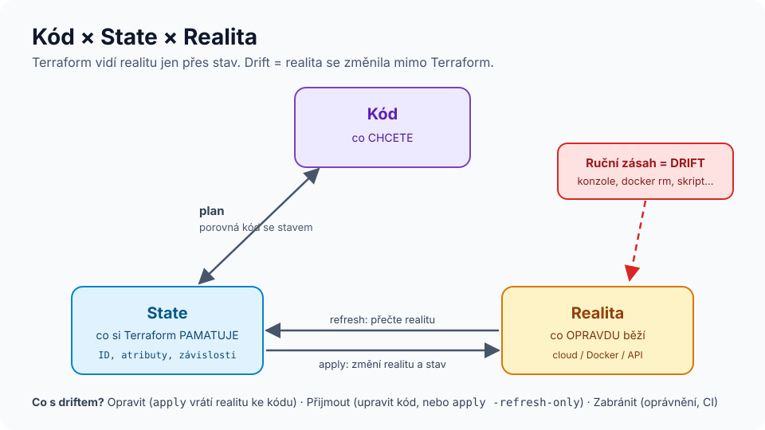

# Modul 05 – State: srdce Terraformu

| Délka | Podcast | Video | Lab |
|---|---|---|---|
| 90 min | 🎧 [Ep. 05 – State](../../podcast/ep05-state.md) | 🎬 [Lekce 05 – State a drift](../../video/README.md#lekce-05) | 🧪 [Lab 04 – State](../../labs/lab04-state/README.md) |

## Cíle
1. **Vysvětlit**, co state obsahuje, proč existuje a proč je citlivý.
2. **Navrhnout** uložení stavu pro tým (vzdálený backend, zamykání, verzování, šifrování, přístupová práva).
3. **Diagnostikovat** drift a zvolit reakci (opravit / přijmout / zabránit).
4. **Refaktorovat** bez výpadku pomocí `import`, `moved` a `removed`.

## Rozcvička
1. Co je implicitní závislost?
2. Proč je `depends_on` poslední možnost?
3. Kdy argument vynutí náhradu zdroje?

---

## 1. Co je state a proč existuje


State je JSON dokument, který mapuje **adresy v kódu** (`docker_container.web`) na **reálné objekty** (ID kontejneru) a pamatuje si jejich poslední známé atributy a závislosti.

Bez něj by Terraform:
- nevěděl, které objekty v cloudu spravuje (a které patří někomu jinému),
- neuměl smazat zdroj, který jste odebrali z kódu (už o něm nic neví),
- musel při každém plánu prohledat celý účet (pomalé, u mnoha API nemožné),
- nemohl spolehlivě určit pořadí mazání (závislosti si pamatuje ve stavu).

```bash
terraform state list                      # adresy ve stavu
terraform state show docker_container.web # atributy jednoho zdroje
terraform show -json | jq '.values.root_module.resources[].address'
```

> ⚠️ **State obsahuje tajemství v čitelné podobě** (hesla, klíče, privátní klíče certifikátů), pokud prošla běžnými argumenty. Ověřili jste si to v labu 02.

## 2. Kam se stavem
| Backend | Zamykání | Poznámka |
|---|---|---|
| `local` (výchozí) | souborový zámek na jednom stroji | jen pro učení a experimenty |
| `s3` | `use_lockfile = true` (nativně v S3, zavedeno v 1.10, stabilní od 1.11); dříve DynamoDB | zapněte verzování a šifrování bucketu |
| `azurerm` | lease na blobu | Azure Storage |
| `gcs` | ano | Google Cloud Storage |
| `pg` | advisory lock v PostgreSQL | vyzkoušíte v labu 04 |
| HCP Terraform / Terraform Enterprise | ano | + běhy v cloudu, politiky, UI |

```hcl
terraform {
  backend "s3" {
    bucket       = "firma-terraform-state"
    key          = "eshop/prod/terraform.tfstate"
    region       = "eu-central-1"
    use_lockfile = true
    encrypt      = true
  }
}
```
**Pravidla pro týmový stav:** vzdálený backend · zamykání · verzování (možnost návratu) · šifrování v klidu · přístup jen pro CI a pár lidí · **jeden stav na prostředí a doménu** (malý „blast radius“).

## 3. Drift
Drift = realita se změnila mimo Terraform (konzole, skript, jiný nástroj, automatické škálování).

| Reakce | Kdy | Jak |
|---|---|---|
| **Opravit** | změna byla chyba | `terraform apply` vrátí realitu ke kódu |
| **Přijmout** | změna byla legitimní | upravit kód; nebo `terraform apply -refresh-only` přijme realitu do stavu |
| **Ignorovat část** | atribut mění někdo jiný záměrně (autoscaling) | `lifecycle { ignore_changes = [desired_count] }` |
| **Zabránit** | opakuje se | práva jen pro čtení v konzoli, změny jen přes CI, plánovaná detekce driftu |

## 4. Refaktoring bez ručních zásahů do stavu
| Situace | Moderní způsob (v kódu, od verze) | Starý způsob (CLI) |
|---|---|---|
| převzít existující objekt | blok `import` (1.5) + `terraform plan -generate-config-out=gen.tf` | `terraform import ADRESA ID` |
| přejmenovat / přesunout do modulu | blok `moved` (1.1) | `terraform state mv` |
| přestat spravovat, ale nemazat | blok `removed` s `destroy = false` (1.7) | `terraform state rm` |

```hcl
import {
  to = docker_network.legacy
  id = "lab04-legacy-sit"
}

moved {
  from = docker_container.web
  to   = docker_container.frontend
}

removed {
  from = docker_volume.data
  lifecycle {
    destroy = false
  }
}
```
**Proč bloky v kódu:** projdou code review, aplikují se stejně ve všech prostředích, jsou vidět v plánu („has moved to“, „will no longer be managed“) a fungují i pro uživatele vašich modulů. Příkazy `terraform state …` mění jeden stav ručně a bez stopy v Gitu.

> **Import není vždy bezeztrátový.** Provider musí umět objekt načíst úplně; ne všechny atributy jdou zpětně zjistit. Vždy cílte na plán `N to import, 0 to add, 0 to change, 0 to destroy` – v labu 04 uvidíte případ, kdy to bez úprav neplatí.

## 5. Workspaces (CLI)
`terraform workspace new test` vytvoří další stav pro **stejnou konfiguraci** (`terraform.workspace` v kódu). Hodí se pro dočasná prostředí (PR preview). Pro dlouhodobé `dev/test/prod` s rozdílnými oprávněními a backendy se obvykle doporučují **oddělené adresáře** nebo samostatné stavy – podrobnosti v [modulu 09](../09-tymova-prace-a-ci-cd/README.md).

---

## Shrnutí
1. State = mapa „kód ↔ realita“ + poslední známé atributy + závislosti.
2. Tým = vzdálený backend se zamykáním, verzováním, šifrováním a úzkým přístupem.
3. Drift opravte, přijměte, nebo mu zabraňte – ale vědomě.
4. `import`, `moved`, `removed` v kódu místo `terraform state …` v terminálu.
5. Malé stavy = malý dopad chyby a rychlejší plány.

## Kvíz
1. Smažete blok `resource` z kódu. Co se stane při `apply` a proč?
2. Dva kolegové spustí `apply` ve stejnou chvíli nad lokálním stavem na sdíleném disku. Co hrozí?
3. Kolega v konzoli zvětšil disk databáze kvůli incidentu. Co uděláte?
4. Proč je `moved` lepší než `terraform state mv` v týmu se 3 prostředími?
5. K čemu je `-generate-config-out` a proč jeho výsledek nelze slepě commitnout?
6. Proč nedávat celou firmu do jednoho stavu?

<details>
<summary>Odpovědi</summary>

1. Terraform zdroj **zničí** – je ve stavu, ale ne v kódu. Pokud ho chcete zachovat, použijte `removed { lifecycle { destroy = false } }`.
2. Souběžný zápis bez spolehlivého zamykání → přepsaný nebo poškozený stav, zdroje „ztracené“ ze stavu, duplicity.
3. Upravím kód na novou velikost (přijmu změnu), aby příští `apply` disk nezmenšoval (to by u většiny databází ani nešlo). Pak prověřím, proč šla změna mimo proces.
4. Blok `moved` se aplikuje automaticky při dalším `apply` v každém prostředí, je v review a v historii. `state mv` musí někdo ručně provést 3× a nesmí se splést.
5. Vygeneruje konfiguraci importovaného objektu. Obsahuje i výchozí a computed hodnoty, někdy chybí atributy, které provider neumí načíst – je to koncept k vyčištění, ne hotový kód.
6. Velký stav = pomalé plány, velký „blast radius“ chyby, zámek blokuje všechny týmy, příliš široká oprávnění.
</details>

## Zdroje
- [State](https://developer.hashicorp.com/terraform/language/state) · [Backends](https://developer.hashicorp.com/terraform/language/backend)
- [Import](https://developer.hashicorp.com/terraform/language/import) · [Refactoring (moved)](https://developer.hashicorp.com/terraform/language/modules/develop/refactoring)
- [Remove resources (removed)](https://developer.hashicorp.com/terraform/language/resources/syntax#removing-resources)

➡️ Lab: [Lab 04 – State](../../labs/lab04-state/README.md) · Další modul: [06 – Meta-argumenty](../06-meta-argumenty/README.md)
