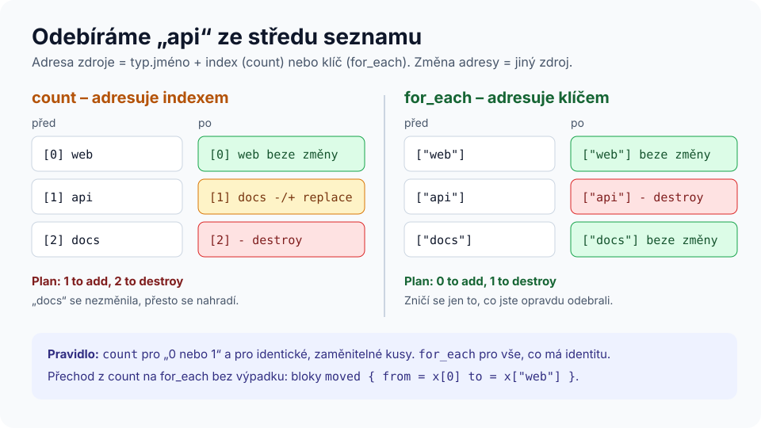

# Modul 06 – Meta-argumenty, `dynamic` a pokročilé výrazy

| Délka | Podcast | Video | Lab |
|---|---|---|---|
| 90 min | 🎧 [Ep. 06 – count vs. for_each](../../podcast/ep06-count-for-each.md) | 🎬 [Lekce 06 – count vs. for_each](../../video/README.md#lekce-06) | 🧪 [Lab 05 – for_each](../../labs/lab05-for-each/README.md) |

## Cíle
1. **Zvolit** mezi `count` a `for_each` a **zdůvodnit** volbu.
2. **Použít** `lifecycle` (`create_before_destroy`, `prevent_destroy`, `ignore_changes`, `replace_triggered_by`, `precondition`/`postcondition`).
3. **Generovat** vnořené bloky pomocí `dynamic`.
4. **Transformovat** data výrazy `for`, `flatten`, `merge(...)`, splat `[*]`.

## Rozcvička
1. Co se stane, když smažete blok `resource` z kódu?
2. Jaký je rozdíl mezi `moved` a `terraform state mv`?
3. Kam patří stav týmu?

---

## 1. Meta-argumenty
Meta-argumenty fungují u **každého** zdroje (a většina u modulů), bez ohledu na providera.

| Meta-argument | Účel |
|---|---|
| `count` | N instancí, adresa `x[0]`, `x[1]` … |
| `for_each` | instance pro každý klíč mapy/množiny, adresa `x["web"]` |
| `depends_on` | explicitní závislost |
| `provider` | výběr konfigurace providera (`aws.usa`) |
| `lifecycle` | úprava životního cyklu a podmínky |

## 2. `count` vs. `for_each`


```hcl
# Podmíněný zdroj – typické použití count
resource "docker_container" "debug" {
  count = var.debug ? 1 : 0
  # …
}

# Kolekce s identitou – for_each
resource "docker_container" "sluzba" {
  for_each = var.sluzby          # map(object) nebo set(string)
  name     = "app-${each.key}"
  ports {
    internal = 80
    external = each.value.port
  }
}
```
**Klíče `for_each` a hodnota `count` musí být známé při plánu.** Odvozujte je ze vstupů a konstant, ne z atributů jiných zdrojů ([Opravárna 04](../../opravarna/04-nezname-klice-for-each/)).

## 3. `lifecycle`
```hcl
resource "aws_db_instance" "hlavni" {
  # …
  lifecycle {
    prevent_destroy       = true                    # plán se zničením skončí chybou
    create_before_destroy = false                   # u DB s pevným jménem nejde
    ignore_changes        = [allocated_storage]     # mění ho storage autoscaling
    replace_triggered_by  = [terraform_data.verze_schematu]

    precondition {
      condition     = var.zalohy_dny >= 7
      error_message = "Produkční databáze musí mít zálohy alespoň 7 dní."
    }
    postcondition {
      condition     = self.storage_encrypted
      error_message = "Databáze musí být šifrovaná."
    }
  }
}
```
| Nastavení | Kdy | Pozor |
|---|---|---|
| `create_before_destroy` | nulový výpadek při náhradě (load balancer, instance za LB) | jména a porty nesmí kolidovat – nová instance existuje souběžně se starou |
| `prevent_destroy` | kritická data | chrání jen při `plan`/`apply`; smazání bloku z kódu ochranu zruší |
| `ignore_changes` | atribut legitimně mění někdo jiný | nadužívání = skrytý drift |
| `replace_triggered_by` | náhrada při změně jiného zdroje | odkazujte na konkrétní zdroj nebo atribut |
| `precondition` / `postcondition` | předpoklady a záruky | vyhodnocuje se pro každou instanci |

## 4. `dynamic` bloky
Opakované **vnořené** bloky (`ingress`, `labels`, `setting`) generuje `dynamic`:
```hcl
dynamic "labels" {
  for_each = merge(var.stitky, { sluzba = each.key })
  content {
    label = labels.key       # iterátor má jméno bloku
    value = labels.value
  }
}
```
Používejte střídmě – příliš mnoho `dynamic` dělá kód nečitelným. Pokud blok generujete z jediné hodnoty, zvažte, zda není lepší modul.

## 5. Transformace dat
```hcl
locals {
  # map(služba) → map(instance) – „flatten pattern“
  instance = merge([
    for nazev, s in var.sluzby : {
      for i in range(s.repliky) : "${nazev}-${i}" => merge(s, { sluzba = nazev, index = i })
    }
  ]...)

  nazvy  = docker_container.backend[*].name            # splat u count
  urls   = { for k, c in docker_container.sluzba : k => "http://localhost:${c.ports[0].external}" }
  verejne = [for k, s in var.sluzby : k if s.verejne]  # filtr
}
```
`flatten()` zploští vnořené seznamy; `merge(...)` s `...` rozbalí seznam map do argumentů.

---

## Shrnutí
1. `count` pro „0 nebo 1“ a identické kusy, `for_each` pro kolekce s identitou.
2. Klíče/počty musí být známé při plánu.
3. `lifecycle` mění chování náhrady a přidává podmínky – každé nastavení má svou cenu.
4. `dynamic` pro opakované vnořené bloky, ale střídmě.
5. `for`, `merge(...)`, `flatten`, `[*]` – základ transformací vstupů na tvar pro `for_each`.

## Kvíz
1. Proč `count = length(var.servery)` vede po odebrání prvního serveru k náhradě ostatních?
2. Proč nejde `for_each = toset(random_pet.x[*].id)`?
3. `create_before_destroy` u kontejneru s pevným `name` – co se stane?
4. Co dělá `ignore_changes = all` a proč je to obvykle špatný nápad?
5. Napište `for` výraz, který z mapy `{ web = { port = 80 }, api = { port = 8080 } }` vrátí seznam portů.
6. Kde je lepší validace proměnné než `precondition`?

<details>
<summary>Odpovědi</summary>

1. Instance jsou adresované indexem; posun indexů změní argumenty instancí → náhrady.
2. Hodnoty `id` jsou známé až po apply, ale klíče `for_each` musí být známé při plánu.
3. Vytvoření nové instance selže na konfliktu jména (stará ještě existuje). Řešení: unikátní jméno (např. s náhodnou příponou) nebo vzdát se `create_before_destroy`.
4. Terraform bude ignorovat všechny změny argumentů – zdroj se po vytvoření prakticky přestane spravovat a drift zůstane skrytý.
5. `[for k, v in var.sluzby : v.port]` nebo `values(var.sluzby)[*].port`.
6. Když kontrolujete jen vstupy: validace proběhne dřív, chyba se vypíše jednou a je u zdroje problému. `precondition` je pro předpoklady, které zahrnují i data z jiných zdrojů nebo data sources.
</details>

## Zdroje
- [The count meta-argument](https://developer.hashicorp.com/terraform/language/meta-arguments/count) · [for_each](https://developer.hashicorp.com/terraform/language/meta-arguments/for_each) · [lifecycle](https://developer.hashicorp.com/terraform/language/meta-arguments/lifecycle)
- [Dynamic blocks](https://developer.hashicorp.com/terraform/language/expressions/dynamic-blocks) · [Custom conditions](https://developer.hashicorp.com/terraform/language/expressions/custom-conditions)

➡️ Lab: [Lab 05 – for_each](../../labs/lab05-for-each/README.md) · Další modul: [07 – Moduly](../07-moduly/README.md)
