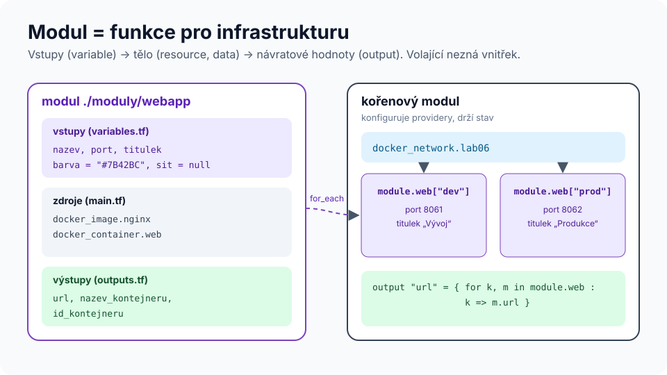

# Modul 07 – Moduly: znovupoužitelná infrastruktura

| Délka | Podcast | Video | Lab |
|---|---|---|---|
| 90 min | 🎧 [Ep. 07 – Moduly](../../podcast/ep07-moduly.md) | 🎬 [Lekce 07 – Moduly](../../video/README.md#lekce-07) | 🧪 [Lab 06 – Moduly](../../labs/lab06-moduly/README.md) |

## Cíle
1. **Navrhnout** rozhraní modulu (vstupy, výstupy) a jeho hranice.
2. **Volat** moduly z různých zdrojů a **verzovat** je.
3. **Skládat** moduly (kompozice) a předávat providery.
4. **Posoudit** kvalitu modulu podle kontrolního seznamu.

## Rozcvička
1. Kdy `count` a kdy `for_each`?
2. Co dělá `prevent_destroy` a co **nedělá**?
3. Proč musí být klíče `for_each` známé při plánu?

---

## 1. Co je modul
**Každý adresář s `*.tf` soubory je modul.** Adresář, kde spouštíte `terraform`, je *kořenový modul*; moduly, které volá blokem `module`, jsou *podřízené*.



```hcl
module "web" {
  source   = "./moduly/webapp"
  for_each = var.prostredi

  nazev   = "app-${each.key}"
  port    = each.value.port
  titulek = each.value.titulek
}

output "url" {
  value = { for k, m in module.web : k => m.url }
}
```
Uvnitř modulu jsou vidět jen jeho vstupy; zvenku jen jeho výstupy. **Zapouzdření** = můžete měnit vnitřek bez dopadu na volající, dokud držíte rozhraní.

## 2. Zdroje modulů a verzování
| Zdroj | Příklad `source` | Verze |
|---|---|---|
| lokální cesta | `./moduly/webapp` | s kódem |
| Terraform Registry | `terraform-aws-modules/vpc/aws` | `version = "~> 5.0"` |
| Git | `git::https://github.com/firma/moduly.git//vpc?ref=v1.4.0` | tag v `ref` |
| privátní registry (HCP) | `app.terraform.io/firma/vpc/aws` | `version = "..."` |
| S3, GCS, HTTP archiv | `s3::https://…/vpc.zip` | v názvu archivu |

**Pravidla:** v produkci vždy pevná verze (tag, ne větev) · sémantické verzování (MAJOR = nekompatibilní změna rozhraní) · CHANGELOG · po změně `source`/`version` spustit `terraform init -upgrade`.

## 3. Providery a moduly
- Modul **deklaruje** potřebné providery v `required_providers`, ale **nekonfiguruje** je (žádný blok `provider`).
- Konfiguraci dědí od volajícího. Jinou konfiguraci předáte explicitně:
  ```hcl
  module "cdn_cert" {
    source    = "./moduly/certifikat"
    providers = { aws = aws.usa }
  }
  ```
- Modul s vlastním blokem `provider` nejde volat s `for_each`/`count`/`depends_on` ([Opravárna 10](../../opravarna/10-provider-v-modulu/)).

## 4. Návrh dobrého modulu
| ✅ Dělejte | ❌ Nedělejte |
|---|---|
| modul řeší **jednu** věc na úrovni, kterou chápe uživatel („webová aplikace“, „síť“) | „wrapper“ kolem jednoho zdroje, který jen kopíruje jeho argumenty |
| málo povinných vstupů, rozumné výchozí hodnoty | desítky přepínačů pro každý případ (*leaky abstraction*) |
| `description` a `type` u každého vstupu a výstupu, validace | `type = any` všude |
| výstupy pro vše, co bude potřebovat navazující kód (ID, URL, jména) | nutit uživatele hledat atributy ve stavu |
| `README.md` s příkladem, `examples/`, testy | modul bez testů a bez příkladu |
| `moved` bloky při refaktoringu uvnitř modulu | přejmenovat zdroj a „ono se to nějak vyřeší“ |

**Kompozice místo dědičnosti:** malé moduly (síť, databáze, aplikace) skládejte v tenkém kořenovém modulu pro každé prostředí. Hluboké vnoření modulů (modul volá modul volá modul…) ztěžuje ladění.

## 5. Registry modulů – kdy použít cizí modul
- **Plus:** rychlý start, ověřené vzory (např. komunitní `terraform-aws-modules`).
- **Mínus:** velké moduly s desítkami přepínačů, závislost na cizím tempu změn, bezpečnost dodavatelského řetězce.
- **Doporučení:** pinujte verzi, čtěte kód před nasazením, sledujte CHANGELOG, zvažte interní „obal“ s firemními výchozími hodnotami.

---

## Shrnutí
1. Modul = adresář; kořenový volá podřízené blokem `module`.
2. Rozhraní = `variable` + `output`; vnitřek je implementační detail.
3. Verze pinujte, tagujte, dodržujte SemVer.
4. Providery konfiguruje jen kořenový modul.
5. Malé, dobře popsané moduly + tenké kořeny pro prostředí.

## Kvíz
1. Jak se adresuje kontejner `web` v instanci modulu `module.web["prod"]`?
2. Proč `ref=main` v Git zdroji modulu není dobrý nápad?
3. Modul má 45 vstupních proměnných. Co to naznačuje?
4. Jak předáte modulu providera AWS pro jiný region?
5. Změnili jste `version` modulu z registry. Co musíte spustit?
6. Kdy je správné, že modul obsahuje jen jeden zdroj?

<details>
<summary>Odpovědi</summary>

1. `module.web["prod"].docker_container.web`
2. Větev se mění – stejný kód by dnes a zítra nasadil něco jiného. Tag (nebo commit SHA) je neměnný.
3. Modul je pravděpodobně jen tenký obal nad API (leaky abstraction) nebo řeší příliš mnoho věcí. Zvažte rozdělení nebo opinionated výchozí hodnoty.
4. `providers = { aws = aws.usa }` v bloku `module` (a `provider "aws" { alias = "usa" … }` v kořeni).
5. `terraform init -upgrade` (případně jen `terraform init`, pokud nová verze odpovídá omezení a modul ještě není stažen).
6. Když přidává hodnotu navíc: firemní výchozí hodnoty, validace, povinné štítky, bezpečné nastavení (např. S3 bucket se šifrováním, verzováním a blokováním veřejného přístupu).
</details>

## Zdroje
- [Modules](https://developer.hashicorp.com/terraform/language/modules) · [Module sources](https://developer.hashicorp.com/terraform/language/modules/sources)
- [Module composition](https://developer.hashicorp.com/terraform/language/modules/develop/composition)
- [Terraform Registry – moduly](https://registry.terraform.io/browse/modules)

➡️ Lab: [Lab 06 – Moduly](../../labs/lab06-moduly/README.md) · Další modul: [08 – Testování](../08-testovani/README.md)
