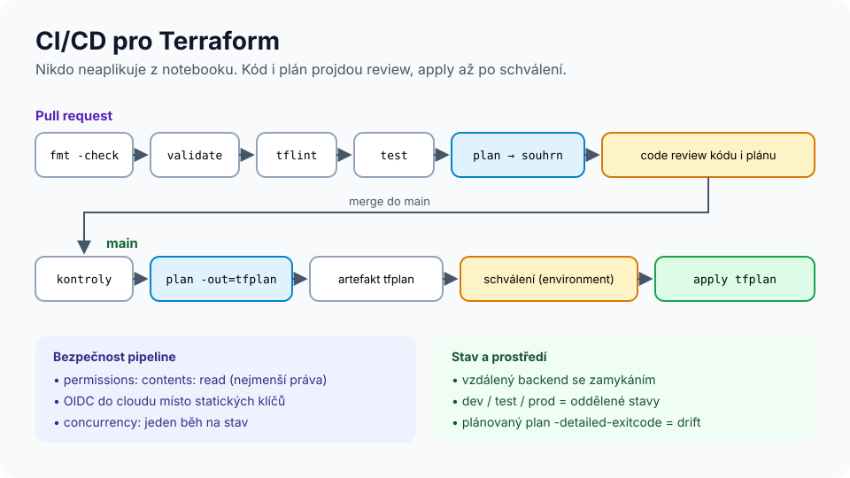

# Modul 09 – Týmová práce, prostředí a CI/CD

| Délka | Podcast | Video | Lab |
|---|---|---|---|
| 90 min | 🎧 [Ep. 09 – Tým a CI/CD](../../podcast/ep09-tym-a-ci-cd.md) | 🎬 [Lekce 09 – CI/CD](../../video/README.md#lekce-09) | 🧪 [Lab 08 – CI/CD](../../labs/lab08-ci-cd/README.md) |

## Cíle
1. **Navrhnout** strukturu repozitáře a oddělení prostředí.
2. **Sestavit** pipeline s kontrolami, plánem, schválením a apply.
3. **Zabezpečit** pipeline: OIDC, nejmenší oprávnění, ochrana stavu a tajemství.
4. **Provádět** review plánu podle kontrolního seznamu.

## Rozcvička
1. Co zachytí `terraform validate` a co ne?
2. Jak napíšete test, který ověří, že validace odmítne špatný vstup?
3. Kde je stav, když Terraform běží v CI?

---

## 1. Prostředí: adresáře, workspaces, nebo nástroje?
| Přístup | Jak | Plus | Mínus |
|---|---|---|---|
| **Oddělené adresáře** | `prostredi/dev`, `prostredi/prod` (tenké kořeny volající stejné moduly) | explicitní, vlastní backend a oprávnění, rozdíly viditelné v kódu | trochu opakování |
| **CLI workspaces** | `terraform workspace select prod` | žádné opakování | stejný backend a práva, snadno aplikovat do špatného prostředí, rozdíly skryté v podmínkách |
| **tfvars per prostředí** | `-var-file=prod.tfvars` + oddělený `key` stavu | jeden kód | backend se musí přepínat (`-backend-config`) |
| **Terragrunt / HCP Terraform / Stacks** | orchestrace nad Terraformem | DRY, závislosti mezi stavy | další nástroj a koncepty |

**Doporučení pro většinu týmů (míra jistoty: konsenzus praxe, ne empirický výzkum):** oddělené adresáře nebo stavy pro dlouhodobá prostředí, workspaces jen pro krátkodobá (preview prostředí pro PR). Závěrečný projekt používá oddělené adresáře.

## 2. Pipeline


1. **PR:** `fmt -check` → `init` → `validate` → `tflint` → bezpečnostní sken → `test` → `plan` → plán do PR (komentář / souhrn).
2. **Review:** člověk čte **kód i plán**.
3. **Merge do main:** znovu `plan -out=tfplan` → schválení (GitHub environment, *required reviewers*) → `apply tfplan`.
4. **Plánovaně (cron):** `plan -detailed-exitcode` → exit code 2 = drift → upozornění.

```yaml
permissions:
  contents: read
  id-token: write        # OIDC do cloudu

concurrency:
  group: terraform-prod
  cancel-in-progress: false
```

### OIDC místo statických klíčů
GitHub Actions umí vystavit krátkodobý **OIDC token**, který cloud (AWS IAM, Azure Entra ID, GCP Workload Identity) vymění za dočasné přihlašovací údaje. V secrets pak nejsou žádné dlouhodobé klíče, a důvěru lze omezit na konkrétní repozitář, větev nebo environment.
```yaml
- uses: aws-actions/configure-aws-credentials@v6
  with:
    role-to-assume: arn:aws:iam::123456789012:role/terraform-ci
    aws-region: eu-central-1
```

### Hotová řešení (TACOS)
Místo vlastní pipeline lze použít specializované platformy: **HCP Terraform / Terraform Enterprise**, **Atlantis** (open source, plán a apply z komentářů v PR), **Spacelift**, **env0**, **Scalr**, **Terrateam**. Výhody: zamykání, politiky, audit, UI. Nevýhody: cena nebo provoz, další systém.

## 3. Review plánu – kontrolní seznam
- [ ] Řádek `Plan:` odpovídá záměru PR (počty add/change/destroy)?
- [ ] Každé `-/+` a `-` je vysvětlené v popisu PR?
- [ ] Žádné změny v IAM/síti/šifrování, o kterých PR nemluví?
- [ ] Žádná tajemství v kódu, `*.tfvars` ani ve výstupech?
- [ ] Nové verze providerů/modulů jsou záměrné (diff `.terraform.lock.hcl`)?
- [ ] Mazání stavových zdrojů (DB, disky, buckety) má `prevent_destroy` nebo zálohu?

## 4. Týmové návyky
- **Malé PR, malé stavy** – menší plán = lepší review, menší dopad chyby.
- **CODEOWNERS** pro citlivé adresáře (`prostredi/prod/`, `moduly/iam/`).
- **Žádný `apply` z notebooku** do sdílených prostředí; výjimky (incident) zdokumentovat a zpětně promítnout do kódu.
- **Konvence:** `terraform fmt`, pojmenování, povinné štítky (modul v labu 07), README u každého modulu.
- **Pre-commit hooky** (např. [pre-commit-terraform](https://github.com/antonbabenko/pre-commit-terraform)) – fmt, validate, tflint, terraform-docs ještě před commitem.

---

## Shrnutí
1. Dlouhodobá prostředí = oddělené stavy (adresáře), workspaces spíš pro dočasná.
2. Pipeline: kontroly → plán → review → schválení → apply uloženého plánu.
3. OIDC, `permissions` minimum, `concurrency`, chráněný stav.
4. Review plánu podle checklistu, ne „vypadá to dobře“.
5. Plánovaná detekce driftu a pravidlo „žádný apply z notebooku“.

## Kvíz
1. Proč je riskantní mít `dev` a `prod` jen jako CLI workspaces?
2. Co vrací `terraform plan -detailed-exitcode` a k čemu to je?
3. Proč OIDC místo `AWS_ACCESS_KEY_ID` v secrets?
4. Proč v jobu apply použít uložený plán z téhož běhu?
5. Co v plánu PR, který mění jen popisek aplikace, vás má zarazit?
6. K čemu je `concurrency` s `cancel-in-progress: false`?

<details>
<summary>Odpovědi</summary>

1. Sdílí backend a oprávnění; prostředí se liší jen hodnotou `terraform.workspace` – snadno spustíte apply do špatného workspace a rozdíly nejsou v kódu vidět.
2. 0 = žádné změny, 1 = chyba, 2 = jsou změny. Pro detekci driftu (plánovaný běh) nebo podmíněné kroky.
3. Krátkodobé tokeny bez dlouhodobých tajemství, důvěra omezená na repozitář/větev/environment, nic k vyzrazení ani rotaci.
4. Aplikuje se přesně to, co prošlo review; Terraform navíc odmítne zastaralý plán, pokud se stav mezitím změnil.
5. Jakékoli `-/+` nebo `-`, změny IAM/sítí, nové verze providerů – nic z toho k popisku nepatří.
6. Dva běhy nad stejným stavem nepoběží souběžně a běžící apply se nepřeruší (přerušený apply = nekonzistentní stav).
</details>

## Zdroje
- [Automate Terraform with GitHub Actions](https://developer.hashicorp.com/terraform/tutorials/automation/github-actions)
- [GitHub: Security hardening with OpenID Connect](https://docs.github.com/en/actions/security-for-github-actions/security-hardening-your-deployments/about-security-hardening-with-openid-connect)
- [Running Terraform in automation](https://developer.hashicorp.com/terraform/tutorials/automation/automate-terraform)

➡️ Lab: [Lab 08 – CI/CD](../../labs/lab08-ci-cd/README.md) · Další modul: [10 – Závěrečný projekt](../10-zaverecny-projekt/README.md)
