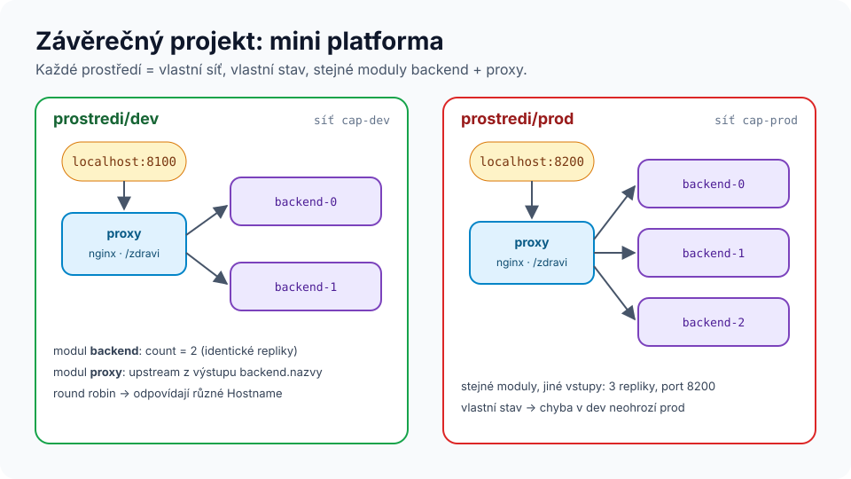

# Modul 10 – Závěrečný projekt a cesta dál

| Délka | Podcast | Lab |
|---|---|---|
| 3–4 h | 🎧 [Ep. 10 – Cesta dál](../../podcast/ep10-cesta-dal.md) | 🏁 [Závěrečný projekt](../../labs/capstone/README.md) |

## Cíle
1. **Navrhnout a postavit** vícevrstvou infrastrukturu s moduly, testy a CI – bez krokového návodu.
2. **Obhájit** návrhová rozhodnutí a jejich alternativy.
3. **Naplánovat** další vlastní rozvoj (reálný cloud, certifikace, pokročilá témata).

---

## 1. Projekt

Zadání, rozhraní, akceptační test a hodnoticí rubrika: [labs/capstone](../../labs/capstone/README.md).

### Organizace (doporučená pro skupinu)
| Čas | Aktivita |
|---|---|
| 0:00 | Tvorba dvojic, přečtení zadání, otázky |
| 0:10 | **Návrh na papír**: architektura, rozhraní modulů, `count` vs. `for_each` |
| 0:30 | Krátká prezentace návrhu jiné dvojici (*peer feedback*: 1 silná stránka, 1 riziko) |
| 0:40 | Implementace – párové programování, role *driver*/*navigator* se střídají po 25 min |
| 2:40 | Akceptační testy, CI, README |
| 3:10 | Code review jiné dvojice přes pull request (checklist z [modulu 09](../09-tymova-prace-a-ci-cd/README.md#3-review-plánu--kontrolní-seznam)) |
| 3:40 | Retrospektiva celé skupiny |

### Retrospektiva (15 min)
Každý napíše na lísteček:
1. Jedna věc, kterou teď umím a před kurzem jsem neuměl/a.
2. Jedna věc, které pořád nerozumím.
3. Jedna věc, kterou zítra použiju v práci.

Body 2 sesbírejte – jsou to témata pro navazující konzultace.

## 2. Kam dál
### Reálný cloud
V tomto repozitáři najdete ukázky pro skutečné cloudy – teď už jim budete rozumět:

| Adresář | Obsah |
|---|---|
| [`aws_samples/`](../../../aws_samples/) | EC2, S3, CloudFront + WAF, Elasticsearch, moduly |
| [`azure_samples/`](../../../azure_samples/) | virtuální stroj v Azure |
| [`gcp_samples/`](../../../gcp_samples/) | VM v Google Cloud |
| [`digitalocean_samples/`](../../../digitalocean_samples/), [`oraclecloud_samples/`](../../../oraclecloud_samples/) | droplet, VCN |
| [`kubernetes/`](../../../kubernetes/) | zdroje v Kubernetes |
| [`custom_provider/`](../../../custom_provider/) | jak napsat vlastní provider v Go |

> ⚠️ Zdroje v cloudu stojí peníze. Nastavte si rozpočet a upozornění, používejte bezplatné úrovně a po cvičení vždy `terraform destroy`. Pro AWS lze lokálně zkoušet i s emulátory (např. LocalStack) – ověřte si aktuální licenční podmínky.

### Pokročilá témata
- Policy as code (OPA/Conftest, Sentinel), cost estimation (Infracost).
- Ephemeral zdroje a write-only argumenty pro tajemství; integrace s Vaultem.
- Terragrunt, HCP Terraform, Terraform Stacks; Atlantis.
- Psaní providerů (Terraform Plugin Framework) – viz [`custom_provider/`](../../../custom_provider/).
- `terraform query` a hromadný import existující infrastruktury (novější verze Terraformu – ověřte v dokumentaci své verze).

### Certifikace
**HashiCorp Certified: Terraform Associate** pokrývá většinu témat kurzu (workflow, state, moduly, proměnné, HCP Terraform). Aktuální verzi zkoušky a osnovu najdete na <https://developer.hashicorp.com/certifications/infrastructure-automation>.

### Opakování
Pokračujte s kartičkami v Anki ještě několik týdnů – rozložené opakování má největší efekt právě v delším horizontu (Cepeda a kol., 2006).

---

## Závěrečný kvíz (míchaný, ze všech modulů)
1. Plán ukazuje `1 to destroy` u zdroje, který jste přejmenovali. Co chybí?
2. Proč nesmí být `terraform.tfstate` v Gitu?
3. Jak zajistíte, že `prod` má vždy aspoň 2 repliky?
4. Proč mock testy nestačí?
5. Kde v pipeline se dělá rozhodnutí člověka?
6. Kdy je `count` lepší než `for_each`?
7. Co dělá `terraform init` a kdy ho musíte spustit znovu?
8. Jak převezmete ručně vytvořený objekt pod správu Terraformu?

Odpovědi

1. Blok `moved { from = staré  to = nové }`.
2. Obsahuje tajemství v čitelné podobě a v týmu potřebuje zamykání; Git neumí ani jedno.
3. Validace proměnné (od 1.9 i s odkazem na jinou proměnnou) nebo `precondition`; plus test s `expect_failures`.
4. Neověří chování skutečného API (kvóty, omezení, oprávnění, časování).
5. Code review kódu a plánu v PR a schválení před apply (environment).
6. Pro podmíněné zdroje (`0`/`1`) a identické zaměnitelné repliky.
7. Stáhne providery a moduly, nastaví backend, vytvoří/ověří lock soubor. Znovu po změně providerů, modulů nebo backendu.
8. Blok `import` (+ `-generate-config-out`), vyčištění konfigurace, plán bez add/destroy, apply.

## Zdroje
- Cepeda, N. J. a kol. (2006). Distributed practice in verbal recall tasks: A review and quantitative synthesis. *Psychological Bulletin* 132(3), 354–380.
- [Terraform tutorials](https://developer.hashicorp.com/terraform/tutorials)
