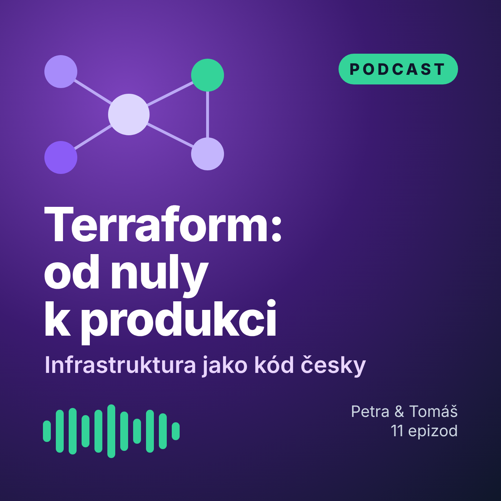

# 🎧 Podcast „Terraform: od nuly k produkci“



Dialog dvou moderátorů – **Petry** (platformní inženýrka) a **Tomáše** (vývojář, s Terraformem začíná). Každá epizoda připraví pojmy, analogie a typické chyby pro jeden modul kurzu a končí **otázkou k vybavení**, na kterou odpovídá začátek další epizody.

**Jak poslouchat:** před lekcí, cestou do práce, ideálně 1–2 dny předem. Podcast lab nenahrazuje – je to předaktivace, aby lekce mohla rovnou do praxe (viz [METODIKA.md](../METODIKA.md)).

| # | Epizoda | Délka | Audio | Přepis |
|---|---|---|---|---|
| 00 | Jak se v kurzu učit (a proč ne tak, jak jsme zvyklí) | 5:10 | [▶ MP3](epizody/ep00-jak-se-ucit.mp3) | [přepis](ep00-jak-se-ucit.md) |
| 01 | Proč infrastruktura jako kód | 5:14 | [▶ MP3](epizody/ep01-proc-infrastruktura-jako-kod.mp3) | [přepis](ep01-proc-infrastruktura-jako-kod.md) |
| 02 | HCL a workflow: init, plán, apply | 4:57 | [▶ MP3](epizody/ep02-hcl-a-workflow.mp3) | [přepis](ep02-hcl-a-workflow.md) |
| 03 | Proměnné, výstupy a mýtus jménem sensitive | 4:32 | [▶ MP3](epizody/ep03-promenne-a-vystupy.mp3) | [přepis](ep03-promenne-a-vystupy.md) |
| 04 | Providery, datové zdroje a graf závislostí | 4:33 | [▶ MP3](epizody/ep04-providery-a-zavislosti.mp3) | [přepis](ep04-providery-a-zavislosti.md) |
| 05 | State: paměť Terraformu | 4:58 | [▶ MP3](epizody/ep05-state.mp3) | [přepis](ep05-state.md) |
| 06 | count, for_each a past jménem index | 4:43 | [▶ MP3](epizody/ep06-count-for-each.mp3) | [přepis](ep06-count-for-each.md) |
| 07 | Moduly: stavebnice, ne kopírka | 4:18 | [▶ MP3](epizody/ep07-moduly.mp3) | [přepis](ep07-moduly.md) |
| 08 | Testování infrastruktury a cvičný požár | 4:35 | [▶ MP3](epizody/ep08-testovani.mp3) | [přepis](ep08-testovani.md) |
| 09 | Tým, prostředí a pipeline | 4:32 | [▶ MP3](epizody/ep09-tym-a-ci-cd.mp3) | [přepis](ep09-tym-a-ci-cd.md) |
| 10 | Závěrečný projekt a cesta dál | 3:38 | [▶ MP3](epizody/ep10-cesta-dal.mp3) | [přepis](ep10-cesta-dal.md) |

Celkem 51 minut.

## Odběr v podcastové aplikaci
RSS feed: [`feed.xml`](feed.xml) – v aplikaci zvolte *Přidat podcast podle URL* a vložte
```
https://raw.githubusercontent.com/ravisileb/terraform_repo/main/skoleni/podcast/feed.xml
```
(funguje po sloučení do větve `main`; ve forku nahraďte vlastníka repozitáře a feed přegenerujte, viz níže).

## Jak epizody vznikají
Hlasy jsou **syntetické**. Zdrojem pravdy jsou přepisy (`ep*.md`); audio se z nich generuje skriptem, takže opravit nebo doplnit epizodu = upravit text a spustit generátor.

```bash
cd skoleni/nastroje/media
pip install edge-tts                       # nejlepší kvalita: neuronové hlasy Vlasta a Antonín (vyžaduje internet)
python3 generuj_podcast.py --backend edge  # všechny epizody, nebo jen: ... --backend edge ep03
python3 generuj_feed.py --zaklad https://raw.githubusercontent.com/<vlastnik>/<repo>/main/skoleni/podcast/
```

| Backend | Kvalita | Poznámka |
|---|---|---|
| `edge` | ★★★ přirozené neuronové hlasy, dva různí mluvčí | online služba Microsoft Edge Read Aloud přes knihovnu `edge-tts` |
| `coqui` | ★★☆ srozumitelné, místy strojové | **offline**, open-source [Coqui TTS](https://github.com/idiap/coqui-ai-TTS) s českým modelem VITS (Common Voice); Tomášův hlas vzniká posunem výšky |
| `espeak` | ★☆☆ robotické | offline nouzovka, `apt install espeak-ng` |

Aktuální soubory MP3 byly vygenerovány backendem **`coqui`** (generování proběhlo v prostředí bez přístupu k online hlasovým službám). Pro výuku doporučujeme epizody jednou přegenerovat backendem `edge` – je to jeden příkaz.

Technické detaily: anglické termíny se pro syntézu přepisují podle [`vyslovnost.tsv`](../nastroje/media/vyslovnost.tsv) (např. *apply* → „eplaj“, *state* → „stejt“), čísla se převádí na slova, výsledek se normalizuje na −16 LUFS (doporučení pro podcasty), MP3 mono 48 kb/s s ID3 tagy a obalem.

**Alternativa s lidskými hlasy:** přepisy jsou napsané jako scénář – klidně je namluvte s kolegou. Podle tzv. *principu hlasu* (Mayer) se lépe učíme z lidského než ze strojového hlasu; novější studie s kvalitními neuronovými hlasy ale rozdíl často nenacházejí (Craig a Schroeder, 2017). Kvalita syntézy tedy hraje roli – další důvod přegenerovat epizody backendem `edge`.
