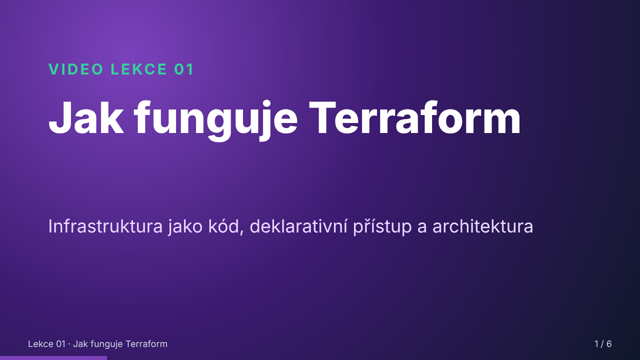
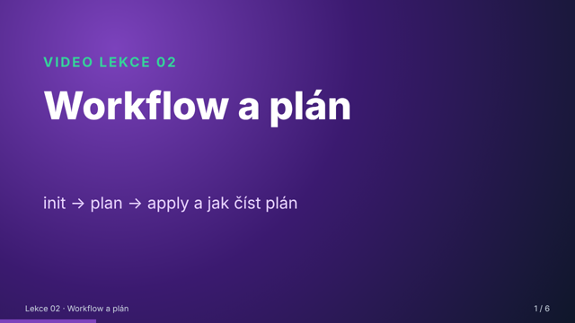
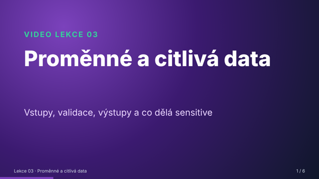
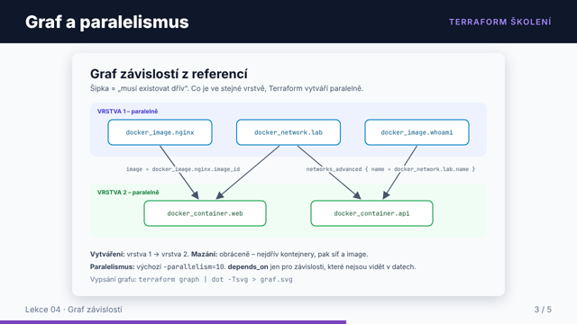
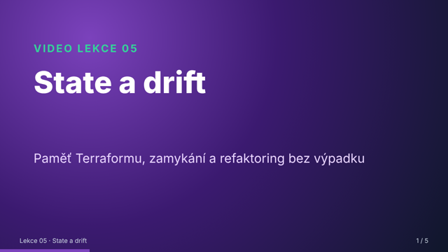
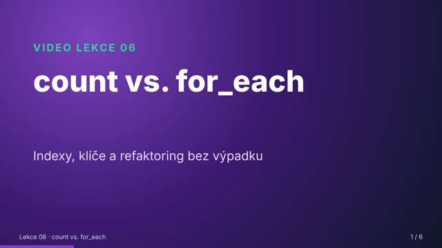
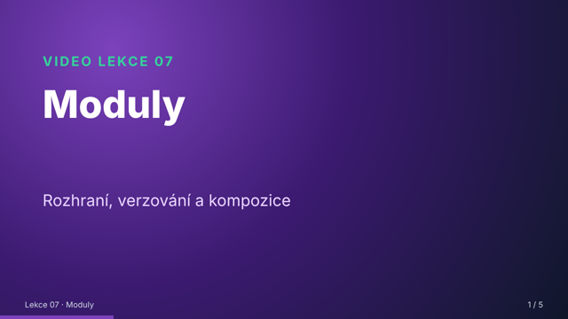
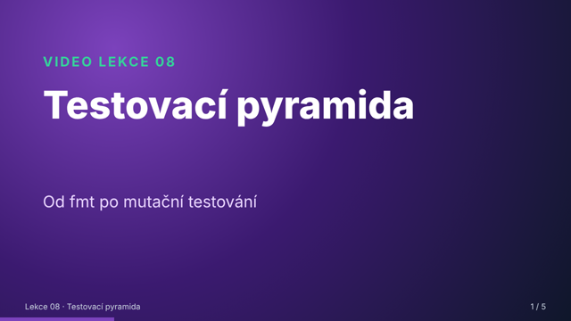
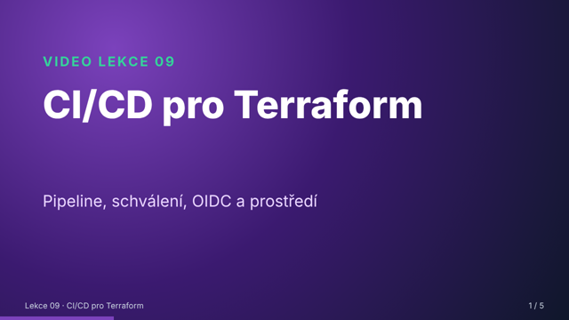
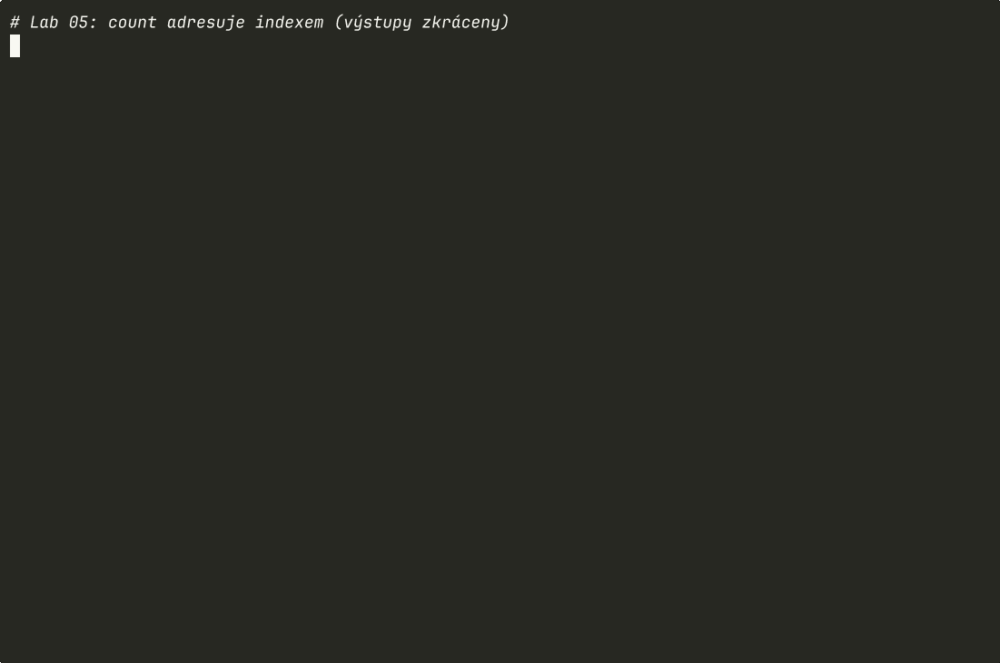

# 🎬 Videa

Dva typy videí, každý s jiným účelem:

| Typ | Účel | Kdy |
|---|---|---|
| **Video lekce** (1–2 min, s narací) | vysvětlení jednoho konceptu: diagram + výklad | před lekcí, spolu s podcastem |
| **Záznamy terminálu** (GIF/MP4, bez zvuku) | skutečný běh Terraformu krok za krokem | v labu, jako „worked example“ |

> **Jak přehrávat:** kliknutím na náhled se otevře MP4 na GitHubu (tlačítko *View raw* / *Download* video přehraje v prohlížeči). Titulky: soubor `.srt` se stejným názvem načte např. VLC nebo mpv automaticky. GIFy se přehrávají přímo v README labů.

## Video lekce
Krátké lekce podle Mayerových principů multimediálního učení: **segmentace** (jeden koncept = jedno krátké video), **signalizace** (diagram, na který narace odkazuje), **koherence** (na slidu minimum textu) a **modalita** (výklad mluveným slovem, ne textem na obrazovce). Každá lekce končí otázkou k vybavení – zastavte video a odpovězte.

### Lekce 01
<a href="lekce/lekce-01-jak-funguje-terraform.mp4"></a>

**Jak funguje Terraform** · 2:01 · [▶ MP4](lekce/lekce-01-jak-funguje-terraform.mp4) · [titulky SRT](lekce/lekce-01-jak-funguje-terraform.srt) · modul [01-proc-iac](../moduly/01-proc-iac/README.md)

### Lekce 02
<a href="lekce/lekce-02-workflow-a-plan.mp4"></a>

**Workflow a plán** · 1:33 · [▶ MP4](lekce/lekce-02-workflow-a-plan.mp4) · [titulky SRT](lekce/lekce-02-workflow-a-plan.srt) · modul [02-hcl-a-workflow](../moduly/02-hcl-a-workflow/README.md)

### Lekce 03
<a href="lekce/lekce-03-promenne.mp4"></a>

**Proměnné a citlivá data** · 1:23 · [▶ MP4](lekce/lekce-03-promenne.mp4) · [titulky SRT](lekce/lekce-03-promenne.srt) · modul [03-promenne-a-vystupy](../moduly/03-promenne-a-vystupy/README.md)

### Lekce 04
<a href="lekce/lekce-04-graf-zavislosti.mp4"></a>

**Graf závislostí** · 1:16 · [▶ MP4](lekce/lekce-04-graf-zavislosti.mp4) · [titulky SRT](lekce/lekce-04-graf-zavislosti.srt) · modul [04-providery-a-zavislosti](../moduly/04-providery-a-zavislosti/README.md)

### Lekce 05
<a href="lekce/lekce-05-state-a-drift.mp4"></a>

**State a drift** · 1:13 · [▶ MP4](lekce/lekce-05-state-a-drift.mp4) · [titulky SRT](lekce/lekce-05-state-a-drift.srt) · modul [05-state](../moduly/05-state/README.md)

### Lekce 06
<a href="lekce/lekce-06-count-vs-for-each.mp4"></a>

**count vs. for_each** · 1:18 · [▶ MP4](lekce/lekce-06-count-vs-for-each.mp4) · [titulky SRT](lekce/lekce-06-count-vs-for-each.srt) · modul [06-meta-argumenty](../moduly/06-meta-argumenty/README.md)

### Lekce 07
<a href="lekce/lekce-07-moduly.mp4"></a>

**Moduly** · 0:59 · [▶ MP4](lekce/lekce-07-moduly.mp4) · [titulky SRT](lekce/lekce-07-moduly.srt) · modul [07-moduly](../moduly/07-moduly/README.md)

### Lekce 08
<a href="lekce/lekce-08-testovaci-pyramida.mp4"></a>

**Testovací pyramida** · 1:05 · [▶ MP4](lekce/lekce-08-testovaci-pyramida.mp4) · [titulky SRT](lekce/lekce-08-testovaci-pyramida.srt) · modul [08-testovani](../moduly/08-testovani/README.md)

### Lekce 09
<a href="lekce/lekce-09-ci-cd.mp4"></a>

**CI/CD pro Terraform** · 1:06 · [▶ MP4](lekce/lekce-09-ci-cd.mp4) · [titulky SRT](lekce/lekce-09-ci-cd.srt) · modul [09-tymova-prace-a-ci-cd](../moduly/09-tymova-prace-a-ci-cd/README.md)


Celkem ~12 minut. Hlas je syntetický (stejné nástroje jako [podcast](../podcast/README.md)).

## Záznamy terminálu
Nahrané ze **skutečných běhů** Terraformu 1.17 a provideru Docker 4.x (výstupy jsou jen zkrácené filtrem `grep`).

| Záznam | Co ukazuje | Lab |
|---|---|---|
|  | `init → plan → apply`, idempotence, replace, `destroy` | [Lab 01](../labs/lab01-prvni-kroky/README.md) |
|  | nginx v Dockeru, replace kvůli změně obsahu, drift po `docker rm` | [Lab 03](../labs/lab03-docker/README.md) |
|  | `import` s generováním konfigurace, `moved` bez zničení | [Lab 04](../labs/lab04-state/README.md) |
|  | past `count`: odebrání prvku ze středu seznamu | [Lab 05](../labs/lab05-for-each/README.md) |

Ke každému záznamu je i MP4 a původní záznam `.cast` – ten přehrajete v terminálu (`asciinema play terminal/lab04-state.cast`) a můžete ho kdykoli pozastavit a kopírovat z něj text.

## Doporučené externí video
- [Introduction to HashiCorp Terraform with Armon Dadgar](https://www.hashicorp.com/resources/introduction-terraform-armon-dadgar-video) – oficiální úvodní whiteboard video spoluzakladatele HashiCorpu (anglicky, s přepisem). Hodí se k modulu 01.
- [Terraform tutorials](https://developer.hashicorp.com/terraform/tutorials) – oficiální interaktivní návody (anglicky).

## Jak videa vznikají
Vše je reprodukovatelné skripty v [`nastroje/media/`](../nastroje/media/):
```bash
cd skoleni/nastroje/media
python3 generuj_videa.py --backend edge        # video lekce (slidy z video_lekce.py → Chromium → PNG, narace, ffmpeg)
./ukazky/nahraj_ukazky.sh                      # záznamy terminálu (asciinema + agg + ffmpeg)
```
Obsah lekcí (slidy i narace) je v [`video_lekce.py`](../nastroje/media/video_lekce.py) – opravit překlep = upravit text a spustit generátor.
